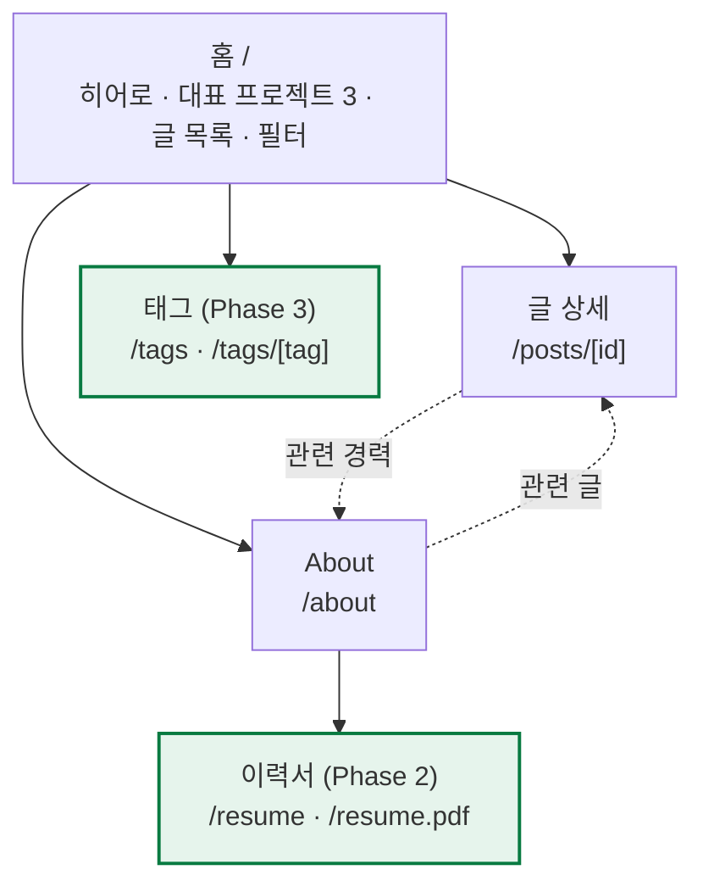
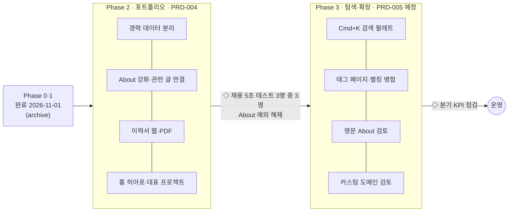

# comstering.github.io 전체 기획서 (마스터 PRD)

> 사이트 전체의 방향, 계속 유효한 규칙, 남은 기능, 로드맵을 정의하는 최상위 기획서. Phase별 실행 기획서는 이 문서의 기능 ID를 참조한다. **Phase 0~1(완료)의 기록은 [archive/phase-0-1_summary.md](./archive/phase-0-1_summary.md)에 있다.**

## 1. 개요

**한 줄 정의:** comstering.github.io는 DevOps·Cloud Native Engineer Comstering이 실무 경험을 글로 증명하고, 그 글이 곧 포트폴리오가 되는 "글 중심 포트폴리오" 사이트다.

### 1.0 작성자 프로필 (콘텐츠·카피 기준)

- 주 직무: **DevOps · Cloud Native Engineer** (CJ Olive Young, 2024.06~). 사이트의 직함·히어로·OG는 이 표현을 기준으로 한다.
- 이전 경력: Class101, **Web Developer (backend 중심)** (2022.05~2024.03).
- 웹 개발 영역(backend·frontend) 안에서는 backend가 강점이다. backend 개발자로 소개하지 않는다.

### 1.1 비전

- 블로그 글(문제 해결 기록)과 커리어(About의 경력·성과)를 서로 연결해, 방문자가 "이 사람은 무엇을 해봤고, 어떻게 생각하는가"를 5분 안에 파악하게 한다.
- 디자인 방향은 **Terminal Graphite**(다크 중심, 단일 그린 포인트, 세로 리스트)를 유지한다. 기준 문서는 저장소 `DESIGN.md`.

### 1.2 목표 (2027년 상반기까지)

| ID | 목표 | 측정 지표 |
| --- | --- | --- |
| G1 | 채용 담당자가 핵심 역량을 빠르게 파악 | About 평균 체류 60초 이상, 이력서 PDF 다운로드 수 |
| G2 | 검색 유입으로 기술 독자 확보 | 월 오가닉 유입 세션(GoatCounter·Search Console), 색인된 글 비율 100% |
| G3 | 꾸준한 발행 습관 | 월 2편 이상 발행 |
| G4 | 품질 기준 유지 | 모든 측정 페이지가 5.1 차단선 통과, 접근성·SEO 100 |

### 1.3 타깃 사용자

| 페르소나 | 상황 | 원하는 것 | 핵심 페이지 |
| --- | --- | --- | --- |
| 채용 담당자·리크루터 | 지원서·링크드인에서 링크 클릭 | 경력, 대표 성과, 연락처를 빠르게 확인 | 홈 소개, About, 이력서 |
| 기술 면접관·현업 엔지니어 | 면접 전 검증 | 깊이 있는 글, 문제 해결 과정, 코드 | 글 상세, About의 관련 글 |
| 검색으로 온 개발자 | EKS·Karpenter·Cilium 에러 검색 | 바로 따라할 수 있는 해결책 | 글 상세(목차, 코드 복사) |
| 본인(작성자) | 글 작성·사이트 운영 | 쉬운 발행, 깨지지 않는 배포 | Markdown, CI/CD |

### 1.4 핵심 가치

1. **증명:** 성과 수치(About)에서 관련 글로 이어진다.
2. **읽기 경험:** 긴 기술 글을 편하게 읽고, 원하는 부분으로 바로 이동한다.
3. **발견성:** 검색엔진과 사이트 내부 검색 모두에서 글이 잘 찾아진다.
4. **낮은 운영 비용:** 정적 사이트 + GitHub Pages, 서버 비용 0원.

## 2. 현재 상태 (2026-11-01)

| 항목 | 상태 |
| --- | --- |
| 완료 | Phase 0 안정화, Phase 1 읽기 경험. 상세는 archive 요약본 |
| 진행 중 | Phase 2 포트폴리오 ([PRD-004](./004_portfolio_projects-and-about.md), approved). 디자인 시안 대기 |
| 스택 | Next.js 16 App Router 정적 export, React 19, Tailwind v4, GitHub Pages, GitHub Actions(CI 품질 게이트 + 자동 배포) |
| 페이지 | 홈(`/`), 글 상세(`/posts/[id]`), About(`/about`), 404, `/rss.xml`, `/sitemap.xml` |
| 알려진 예외 | About의 성능·CLS·TBT가 품질 차단선 예외(`warn`). Phase 2 PR-19에서 해제 (5.1) |

## 3. 정보 구조(IA)·사용자 여정

헤더 내비는 `posts · about`. 별도 Projects 페이지는 두지 않고(2026-10-30 결정), 경력의 깊이는 About의 관련 글 링크와 블로그가 맡는다.



모든 페이지 공통: 헤더 · 테마 토글 · 푸터(GitHub, LinkedIn, email, RSS) · ⌘K 검색(Phase 3).

| 여정 | 시작점 | 경로 | 성공 상태 |
| --- | --- | --- | --- |
| J1 채용 검토 | 이력서·LinkedIn 링크 | 홈 소개 → 대표 프로젝트 → About 해당 항목 → 관련 글 / 이력서 PDF | 3분 안에 경력·대표 성과·연락처 확인 |
| J2 검색 유입 | 구글·네이버 검색 결과 | 글 상세 → 목차 → 코드 복사 → 시리즈 다음 편 / 관련 글 | 문제 해결 + 두 번째 페이지 조회 |
| J3 구독·재방문 | RSS, 링크드인 공유 | 글 상세 → 댓글 / 저자 박스 → About | 댓글·반응, RSS 등록 |
| J4 주제 탐색 | 홈 | 카테고리 칩 또는 ⌘K → 태그 페이지 → 글 | 원하는 주제 글 3편 이상 발견 |
| J5 글 발행(작성자) | 로컬 마크다운 | `draft: true`로 작성 → PR(스키마 검증·빌드·품질 게이트) → 머지 → 자동 배포 | 머지 후 10분 안에 라이브 |

## 4. 남은 기능 명세

Phase 0~1에서 끝난 기능(F-GL-01~04, F-HM-03·04, F-PO-01~12, F-SE-01~08 등)은 archive에 있다. 아래는 아직 만들지 않은 기능이다. 우선순위는 P0(그 기능을 만들 때 필수)·P1(권장)·P2(여유 있을 때)이고, 언제 만드는지는 7장 Phase가 정한다.

### 4.1 Phase 2 (PRD-004에서 상세화)

| ID | 기능 | 요약 |
| --- | --- | --- |
| F-PJ-01 | 경력 데이터 분리 | About 내용을 `content/profile.yaml`·`experience.yaml`로. About·홈·이력서가 같은 데이터 사용 |
| F-AB-01 | About 요약 우선 | 첫 화면에 이름·직함·연차·회사·연락처 (5초 테스트) |
| F-AB-02 | 경력 타임라인 | 회사별 프로젝트, 관련 글 링크(`personal`/`work`), 앵커 도착 강조 |
| F-AB-03 | 자격증·학력·활동 | Terraform Associate Credly 링크 |
| F-AB-04 | 이력서 | `/resume` + 빌드 때 자동 생성 PDF, 사진 없음 |
| F-HM-01·02 | 홈 히어로·대표 프로젝트 | 대표 3건은 About 항목으로 연결 |
| F-PO-09 (보완) | 글 → 경력 연결 | 글 `relatedProject`가 있으면 저자 박스에 `관련 경력 →` |

### 4.2 Phase 3 (PRD-005 작성 예정)

| ID | 기능 | 요구사항 | 우선 |
| --- | --- | --- | --- |
| F-SR-01 | 명령 팔레트 | `Cmd/Ctrl+K`와 헤더 버튼으로 열기. 글·태그를 한 번에 검색. 방향키 이동, Enter 이동, Esc 닫기, 포커스 트랩 | P1 |
| F-SR-02 | 검색 인덱스 | 빌드 타임 정적 인덱스(title, description, tags, 본문 앞부분, headings) 또는 Pagefind (8.2 결정) | P1 |
| F-SR-03 | 한글 검색 | 초성·부분 일치, 영문 대소문자 무시, 별칭 사전(예: "카펜터" → Karpenter) | P2 |
| F-SR-04 | 태그 페이지 | `/tags`(글 수 포함), `/tags/[tag]`. `content/tags.yaml` 별칭 병합(k8s → kubernetes) | P1 |
| F-AB-05 | 영문 About | `/en/about`. 블로그는 한국어 유지 (8.2 결정) | P2 |
| F-HM-05 | 페이지네이션 | 글 30편 초과 시 도입 | P2 |

### 4.3 보류

| ID | 기능 | 보류 이유 / 다시 볼 조건 |
| --- | --- | --- |
| F-PJ-02 | `/projects` 목록 | About 경력과 내용이 겹침. 프로젝트가 About에서 읽기 어려울 만큼 늘면 |
| F-PJ-03 | 프로젝트 상세 | About 설명·불릿과 대부분 같음. 길게 쓸 이야기는 블로그 글로 |
| F-SE-09 | AdSense | 지금은 제거. 재도입 조건: 글 상세 본문 하단 1곳만, 광고 포함 상태에서 5.1 차단선 유지, 홈·About에는 노출 안 함. `ads.txt`·계정은 유지 |

### 4.4 Phase 3 수용 기준 (초안)

| ID | 수용 기준 | 검증 |
| --- | --- | --- |
| F-SR-01 | 마우스 없이 `Cmd+K` → 검색어 → ↓ → Enter로 글에 도달. 첫 결과 표시 100ms 이내(글 100편 기준) | E2E |
| F-SR-04 | `k8s`와 `kubernetes`가 한 페이지로 병합, 모든 태그 페이지가 sitemap에 존재 | 빌드 산출물 검사 |

## 5. 품질 기준 (모든 Phase 공통)

### 5.1 성능 측정 기준

**측정 방식: 실제 Chrome 관측.** Lighthouse CI, 모바일 프리셋, `throttlingMethod: "devtools"`(느린 4G 수준 네트워크·CPU 4배 제한을 실제로 걸고 관측), 리눅스 CI 러너, 페이지마다 **3회 측정 중앙값**(`aggregationMethod: "median-run"`). 대상: 홈·글 상세·About(+ Phase별 추가 페이지).

| 등급 | 의미 | 성능 | LCP | CLS | TBT | 접근성 / SEO | 모범사례 |
| --- | --- | --- | --- | --- | --- | --- | --- |
| **차단 (error)** | 넘으면 PR 머지 불가 | ≥ 90 | ≤ 2.5s | ≤ 0.1 | ≤ 300ms | 100 / 100 | — |
| **목표 (warn)** | PR 댓글에 경고 | ≥ 95 | ≤ 2.0s | ≤ 0.05 | ≤ 200ms | — | ≥ 95 (`is-on-https` 제외) |

- 측정 조건을 문구에 반드시 적는다. 시뮬레이션(Lighthouse 기본)은 웹 글꼴 크기를 LCP에 그대로 더하는 계산 모델이라 쓰지 않는다(경위는 archive 4장).
- 차단선을 넘으면 숫자를 조용히 낮추지 않고 기획에 묻는다. 예외는 범위와 기한을 정해서만 둔다.
- **현재 예외:** About의 성능·CLS·TBT만 `warn`(개발 Q13·Q15). Phase 2 PR-19에서 차단선(CLS ≤ 0.1 포함) 통과 후 해제.
- 실사용 Core Web Vitals(75퍼센타일)는 Search Console에 데이터가 생기면 분기마다 보는 참고 지표.

### 5.2 그 밖의 품질 기준

| 항목 | 기준 | 측정 |
| --- | --- | --- |
| 초기 JS (글 상세) | ≤ 120KB gzip | `next build` 출력 |
| 본문 이미지 | ≤ 200KB (WebP 변환) | 빌드 산출물 검사 |
| 깨진 링크 | 0건 | 링크 체커(주 1회 + PR) |
| 빌드 시간 | ≤ 3분 (CI 전체는 15분 제한) | Actions 로그 |
| 디자인 토큰 | `src/`에 금지 색 패턴·hex·시안 표시(`.ph`) 0건 | CI 검사 |

### 5.3 비즈니스 KPI (분기 단위 점검)

| KPI | 목표 | 데이터 소스 |
| --- | --- | --- |
| 월 순방문자 | 기준치 측정 후 분기 +30% | GoatCounter |
| 검색 노출 → 클릭률(CTR) | ≥ 3% | Google Search Console, 네이버 서치어드바이저 |
| 색인된 페이지 | sitemap URL의 100% | Search Console |
| 글 → About 이동률 | ≥ 5% | GoatCounter 이벤트 또는 referrer |
| 발행 빈도 | 월 2편 | Git 로그 |
| RSS 구독 요청 | 기준치 측정 | `/rss.xml` 조회수 |
| 채용 관련 연락 | 분기 1건 이상 | 메일·LinkedIn 수신 |

## 6. 운영 규칙 (계속 유효)

### 6.1 콘텐츠 스키마

```yaml
title: "EKS에 Karpenter 설치"     # 필수
description: "..."                # 필수, 80–160자 권장, 글마다 고유
date: "2025-07-07"                 # 필수. 작성자가 적은 날짜만 사용(수정일 표시 없음)
categories: [infra]                # 필수, 1~2개: infra | backend | frontend | oss | note
tags: [kubernetes, eks]            # 필수, content/tags.yaml에 등록된 값만
series: eks-from-scratch           # 선택, content/series.yaml에 등록
seriesOrder: 3                     # series가 있으면 필수
draft: false                       # 선택, true면 프로덕션·sitemap·RSS에서 제외
relatedProject: eks-networking     # 선택, About 경력 프로젝트 id (Phase 2)
```

| 규칙 | 내용 |
| --- | --- |
| categories | 대표 없음. 표시는 고정 순서(`infra · backend · frontend · oss · note`), 쉼표로 묶음. 필터는 모든 값으로 걸림. 0편 카테고리는 칩 숨김 |
| 시리즈 | `content/series.yaml`(slug, title, label). `label`은 8자 이하 |
| 썸네일 | 없음. 공유 이미지는 빌드 때 OG 자동 생성(PNG) |
| 본문 문법 | 코드 펜스 `title="..."`·줄 하이라이트, `> [!NOTE]`·`> [!WARNING]` 콜아웃. 기존 글에는 소급하지 않음 |
| 빌드 검증 | 규칙 위반(필수 필드, 미등록 태그·시리즈, 중복 description, `updated`·`thumbnail` 등 폐기 필드)이 있으면 빌드 실패 |

### 6.2 콘텐츠·공개 원칙

| 원칙 | 내용 |
| --- | --- |
| 공개 범위 | 블로그·About에 이미 공개된 내용은 사용 가능. 새 사내 정보(내부 수치, 회사 환경의 CIDR·계정·도메인, 사내 아키텍처 그림)는 작성자 확인 |
| 회사 vs 개인 | 회사 성과 수치(About)와 개인 EKS 실습 글(블로그)은 환경이 달라 수치가 다르다. 섞어 보이지 않고 개인 글은 `personal`로 표시 |
| 합산 수치 | 성과를 합쳐 하나의 큰 숫자로 만들지 않는다 |
| URL | `/posts/[id]`는 파일명 기준으로 고정. 바꾸면 검색 순위·댓글(Giscus `pathname` 매핑)이 끊긴다 |

### 6.3 비기능 요구사항

| ID | 영역 | 요구사항 |
| --- | --- | --- |
| NF-01 | 성능 | 서드파티 스크립트(GoatCounter, Giscus)는 지연 로드. 글꼴은 사이트가 쓰는 글자만 담은 단일 서브셋, `swap`, preload 없음 |
| NF-02 | 성능 | 본문 이미지는 빌드 때 WebP 변환·리사이즈, 원본은 저장소에만 |
| NF-03 | 접근성 | WCAG 2.2 AA. 대비 4.5:1 이상(글자색을 `opacity`로 낮추지 않음), 키보드만으로 모든 기능 사용, 버튼 이름에 보이는 글자 포함, 제목 단계 건너뛰지 않음, `prefers-reduced-motion` 존중 |
| NF-04 | 반응형 | 360px 폭에서 가로 스크롤 0(코드 블록·표 내부 제외), 터치 타깃 44×44px 이상 |
| NF-05 | SEO | 페이지당 h1 1개, 고유 title·description, 정규 URL 하나, 네이버·구글 소유확인 파일 유지 |
| NF-06 | 보안 | 외부 링크 `rel="noopener noreferrer"`. CSP로 허용 도메인 제한 검토 |
| NF-07 | 보안·공개성 | 글·이미지 속 회사 민감 정보 마스킹 확인(6.2) |
| NF-08 | 프라이버시 | GoatCounter(쿠키 없음) 유지. AdSense 재도입 시 개인정보처리방침 페이지 추가 |
| NF-09 | 유지보수 | 콘텐츠 접근은 `src/lib/content/` 한 곳에서. 의존성은 정기 업데이트, 메이저 업그레이드는 품질 게이트 비교 후 머지 |
| NF-10 | 문서 | README에 글 작성·경력 수정·배포 방법. 세션별 `CONTEXT.md`·`STATUS.md` 갱신 |
| NF-11 | 비용 | 월 운영비 0원(GitHub Pages, GoatCounter, Giscus). 커스텀 도메인은 연 비용만 허용 |

## 7. 로드맵·백로그



- **PRD-005 작성 전에 작성자에게 먼저 물을 것:** ① 커스텀 도메인 사용 여부 ② 영문 About 필요 여부.
- Phase 3 이후는 분기마다 5.3 KPI를 점검하며 백로그에서 골라 진행한다.

### 7.1 백로그 (후보)

| 항목 | 기대 효과 | 난이도 |
| --- | --- | --- |
| "지금 하는 일" `/now` 페이지 | 최근 관심사·학습 공유 | 하 |
| 글 끝 반응(Giscus reactions 활용) | 독자 피드백 | 하 |
| 뉴스레터(Buttondown 등 무료) | 재방문 채널. 구독 수요 확인 후 | 중 |
| Mermaid 다이어그램 본문 지원(빌드 타임 SVG) | 아키텍처 글 가독성. 글에 필요할 때만 | 중 |
| AdSense 재도입 검토 | 4.3 F-SE-09 조건 | 하 |

## 8. 리스크·열린 결정

### 8.1 리스크

| 리스크 | 대응 |
| --- | --- |
| About의 수치 검증 질문에 답하지 못함 | 수치마다 측정 방법·기간을 개인 메모로 보관, 근거 없는 수치는 삭제 |
| URL 변경으로 검색 순위·댓글 유실 | 6.2 URL 원칙 |
| 기능 추가로 발행이 뒷전 | 분기마다 개발 1 : 글 2 비율, 발행을 로드맵 항목에 포함 |
| 세션 간 `cowork/` 문서 덮어쓰기 | 동기화 커밋은 최신본 기준. 끝난 Phase 문서는 archive로 요약 후 삭제 |

### 8.2 열린 결정

- [ ] **커스텀 도메인:** comstering.github.io 유지 vs 개인 도메인(예: comstering.dev). canonical·댓글 매핑에 영향, 이를수록 좋음 (PRD-005 전에 확인)
- [ ] **영문 About:** 필요 여부 (PRD-005 전에 확인)
- [ ] **검색 엔진:** 직접 만든 JSON 인덱스(가벼움) vs Pagefind(본문 전체 검색, 수십 KB 추가)
- [ ] **MDX:** 지금은 도입하지 않음. 본문에 컴포넌트가 필요해지면 다시 판단
