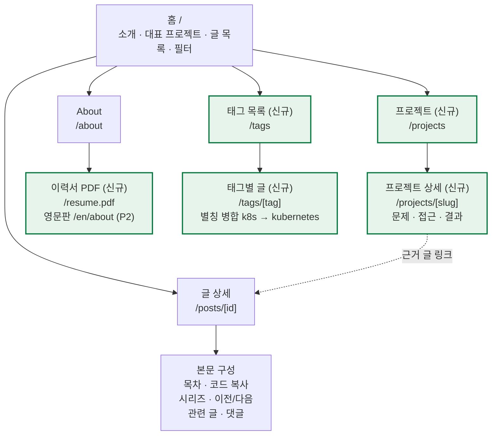
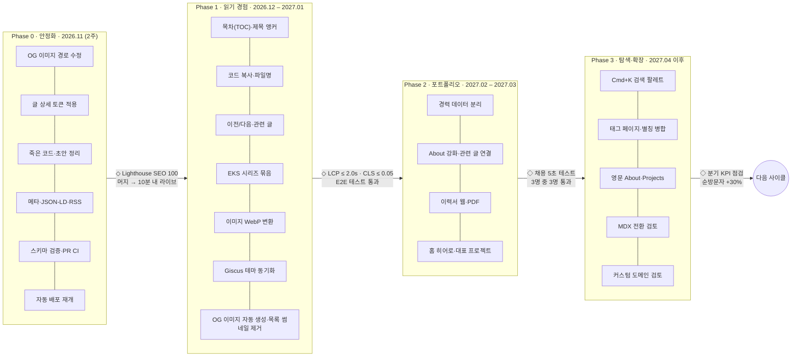

# comstering.github.io 전체 기획서 (마스터 PRD)

> 사이트 전체의 비전·기능 명세·성공 기준·로드맵을 정의하는 최상위 기획서. 이후 영역별 PRD(002~)는 이 문서의 기능 ID를 참조해 상세화한다.

## 1. 개요

**한 줄 정의:** comstering.github.io는 DevOps·Cloud Native Engineer Comstering이 실무 경험을 글로 증명하고, 그 글이 곧 포트폴리오가 되는 "글 중심 포트폴리오" 사이트다.

### 1.0 작성자 프로필 (콘텐츠·카피 기준)

- 주 직무: **DevOps · Cloud Native Engineer** (CJ Olive Young, 2024.06~). 사이트의 직함·히어로·OG는 이 표현을 기준으로 한다.
- 이전 경력: Class101에서 backend 비중이 큰 웹 개발 (2022.05~2024.03).
- 웹 개발 영역(backend·frontend) 안에서는 backend가 강점이다. backend 개발자로 소개하지 않는다.

### 1.1 비전

- 블로그 글(문제 해결 기록)과 커리어(프로젝트·성과)를 서로 연결해, 방문자가 "이 사람은 무엇을 해봤고, 어떻게 생각하는가"를 5분 안에 파악하게 한다.
- 디자인 방향은 이미 정한 **Terminal Graphite**(다크 중심, 단일 그린 포인트, 세로 리스트)를 유지한다.

### 1.2 목표 (2027년 상반기까지)

| ID | 목표 | 측정 지표 |
| --- | --- | --- |
| G1 | 채용 담당자가 핵심 역량을 빠르게 파악 | About/Projects 페이지 평균 체류 60초 이상, 이력서 PDF 다운로드 수 |
| G2 | 검색 유입으로 기술 독자 확보 | 월 오가닉 유입 세션(GoatCounter·Search Console), 색인된 글 비율 100% |
| G3 | 꾸준한 발행 습관 | 월 2편 이상 발행, 초안→발행 소요 시간 단축 |
| G4 | 품질 기준 유지 | 모든 측정 페이지가 PRD-003 "성능 측정 기준" 차단선 통과, 접근성·SEO 100 |

### 1.3 타깃 사용자

| 페르소나 | 상황 | 원하는 것 | 핵심 페이지 |
| --- | --- | --- | --- |
| 채용 담당자·리크루터 | 지원서·링크드인에서 링크 클릭 | 경력, 대표 프로젝트, 연락처를 빠르게 확인 | 홈 소개, About, Projects |
| 기술 면접관·현업 엔지니어 | 면접 전 검증 | 깊이 있는 글, 문제 해결 과정, 코드 | 글 상세, 관련 글 |
| 검색으로 온 개발자 | EKS·Karpenter·Cilium 에러 검색 | 바로 따라할 수 있는 해결책 | 글 상세(목차, 코드 복사) |
| 본인(작성자) | 글 작성·사이트 운영 | 쉬운 발행, 깨지지 않는 배포 | Markdown, CI/CD |

### 1.4 핵심 가치

1. **증명:** 성과 수치(About)마다 근거가 되는 글이나 프로젝트로 연결한다.
2. **읽기 경험:** 긴 기술 글을 편하게 읽고, 원하는 부분으로 바로 이동한다.
3. **발견성:** 검색엔진과 사이트 내부 검색 모두에서 글이 잘 찾아진다.
4. **낮은 운영 비용:** 정적 사이트 + GitHub Pages 그대로, 서버 비용 0원을 유지한다.

## 2. 현황 진단

디자인 시스템 3단계(토큰·셸·홈)까지는 끝났고, 글 상세·About·SEO·배포에 실제 버그와 미완성 영역이 남아 있다. 자동 배포가 멈춰 있어, 현재 라이브 사이트와 main 브랜치가 다를 수 있다. (2026-10-27 저장소 기준)

### 2.1 기술 스택

| 영역 | 현재 | 비고 |
| --- | --- | --- |
| 프레임워크 | Next.js 15.2.4 App Router, React 19, TS 5 | `output: "export"` 정적 빌드 |
| 스타일 | Tailwind v4 + typography, DESIGN.md 토큰 | Pretendard + JetBrains Mono |
| 콘텐츠 | `posts/*.md` 15편, gray-matter + remark/rehype | frontmatter: title, date, description, categories, tags, thumbnail |
| 부가 기능 | next-themes, Giscus 댓글, GoatCounter 조회수, AdSense | AdSense는 전 페이지에 로드 |
| 배포 | GitHub Actions → GitHub Pages | main push 트리거 주석 처리(수동 배포만 가능) |

### 2.2 페이지 구성

| 경로 | 상태 | 내용 |
| --- | --- | --- |
| `/` | 토큰 적용 완료 | 히어로 + 검색 + 카테고리 칩 + 연도별 세로 리스트 |
| `/posts/[id]` | 미적용 | `gray-*`, `sky-*`, `dark:`, 큰 그림자 등 DESIGN.md 금지 패턴 다수 |
| `/about` | 미적용 | 경력·프로젝트 12건 이상이 TSX에 하드코딩 |
| 404 | 미적용 | `not-found.tsx` 존재 |
| Projects | 없음 | 포트폴리오 전용 페이지 부재 |

### 2.3 강점

- 디자인 토큰과 금지 규칙이 문서화(DESIGN.md)되어 있고, 홈은 이미 기준을 따른다.
- EKS·Karpenter·Cilium·Terraform·오픈소스 기여 등 주제가 일관되어 전문성이 뚜렷하다.
- About의 성과가 정량적이다(예: MWAA 제거 연 $16,000 절감, Pod IP 500→16,000).
- 스킵 링크, `:focus-visible`, `lang="ko"` 등 접근성 기본기가 있다.

### 2.4 발견한 문제 (코드 기준)

| # | 심각도 | 위치 | 문제 | 영향 |
| --- | --- | --- | --- | --- |
| P1 | 높음 | `posts/[id]/page.tsx` generateMetadata | OG 이미지 URL이 `https://comstering.github.io/<파일명>`으로, `/images/posts/thumbnails/` 경로가 빠짐 | 링크드인·카톡 공유 시 미리보기 이미지 404 |
| P2 | 높음 | `.github/workflows/deploy.yaml` | main push 자동 배포 중단 상태 | 머지해도 라이브에 반영 안 됨 |
| P3 | 높음 | `package.json` vs CLAUDE.md | 문서는 `yarn deploy`(gh-pages)를 안내하지만 스크립트가 없고, 실제는 Actions 방식 | 배포 경로 2개가 혼재, gh-pages 의존성 불필요 |
| P4 | 중간 | `SearchModal.tsx` | 정적 export에서 동작하지 않는 `/api/posts`를 호출하고, 링크가 `/post/`(오탈자). 어디서도 쓰이지 않음 | 죽은 코드. `src/api/posts/route.ts`도 app 밖이라 무의미 |
| P5 | 중간 | `posts/operator-lifecycle-manager.md` | 12줄짜리 초안. description·tags·thumbnail이 karpenter 글에서 복사된 그대로 (현재 git 미추적 상태) | 발행 시 얇은 콘텐츠, 중복 메타로 SEO 패널티 |
| P6 | 중간 | Giscus `theme="preferred_color_scheme"` | 사이트 기본은 다크(시스템 무시)인데 댓글은 OS 설정을 따름 | 다크 페이지에 흰 댓글 박스 |
| P7 | 중간 | layout.tsx 메타 | `metadataBase`, canonical, Twitter card, JSON-LD, RSS 없음 | 검색·공유 품질 저하 |
| P8 | 중간 | `public/images` | 총 29MB, 썸네일 한 장이 1.5MB PNG, 이미지 최적화 없음(unoptimized) | LCP 저하, 모바일 데이터 낭비 |
| P9 | 낮음 | 태그·카테고리 | `k8s`/`kubernetes`, `IaC`/`iac` 혼재. `project`가 카테고리이자 태그 | 필터·태그 페이지 품질 저하 |
| P10 | 낮음 | sitemap.ts | 홈·About의 `lastModified`가 빌드할 때마다 현재 시각 | 크롤러에 잘못된 갱신 신호 |
| P11 | 낮음 | `posts/[id]` 404 분기 | `readFileSync`가 먼저 예외를 던져 도달 불가능한 코드 | 죽은 코드 |
| P12 | 낮음 | README, CONTEXT.md | README는 create-next-app 기본값, CONTEXT는 "14개 포스트", 이미 된 작업(조회수, sitemap)이 TODO로 남음 | 문서 신뢰도 저하 |
| P13 | 낮음 | 품질 게이트 | `test/` 비어 있음, PR 빌드·린트 CI 없음 | 회귀 발견 늦음 |

### 2.5 경쟁·참고 사이트에서 빠진 것

참고로 삼은 toss.tech, joshwcomeau.com 수준과 비교하면 목차, 코드 복사, 이전/다음·관련 글, 시리즈 묶음, RSS, 태그 페이지, 프로젝트 상세 페이지가 빠져 있다.

## 3. 정보 구조(IA)·사용자 여정

헤더 내비는 `posts` `projects` `about` 3개로 고정하고, 태그는 글 안의 링크와 검색으로 들어간다. 프로젝트 상세와 글 상세는 서로 링크해 "성과 → 근거 글" 흐름을 만든다.



모든 페이지 공통: 헤더 내비 · Cmd+K 검색 · 테마 토글 · 푸터(GitHub, LinkedIn, RSS) · 404 · `/rss.xml` · `/sitemap.xml`

### 3.1 주요 사용자 여정

| 여정 | 시작점 | 경로 | 성공 상태 |
| --- | --- | --- | --- |
| J1 채용 검토 | 이력서·LinkedIn 링크 | 홈 소개 → About → 프로젝트 상세 → 근거 글 | 3분 안에 경력·대표 성과·연락처 확인, PDF 다운로드 |
| J2 검색 유입 | 구글·네이버 검색 결과 | 글 상세 → 목차로 점프 → 코드 복사 → 시리즈 다음 편 / 관련 글 | 문제 해결 + 두 번째 페이지 조회 |
| J3 구독·재방문 | RSS, 링크드인 공유 | 글 상세 → 댓글 / 저자 박스 → About | 댓글·반응, RSS 등록 |
| J4 주제 탐색 | 홈 | 카테고리 칩 또는 Cmd+K → 태그 페이지 → 글 | 원하는 주제 글 3편 이상 발견 |
| J5 글 발행(작성자) | 로컬 마크다운 | `draft: true`로 작성 → PR(스키마 검증·빌드) → 머지 → 자동 배포 | 머지 후 10분 안에 라이브, 수동 단계 0 |

## 4. 기능 명세

우선순위는 P0(해당 기능을 만들 때 반드시 포함), P1(같은 단계 안에서 권장), P2(여유 있을 때)로 나눈다. **언제 만드는지는 7장 로드맵의 Phase가 정한다.** 예: F-PO-03 TOC는 P0 기능이지만 Phase 1에서 만든다. Phase 0의 범위는 7.1 작업 목록과 PRD-002가 정한다. 모든 기능은 정적 export·서버 없음 제약을 지킨다.

### 4.1 글로벌

| ID | 기능 | 요구사항 | 우선 |
| --- | --- | --- | --- |
| F-GL-01 | 헤더 내비 | `posts` `projects` `about` 3개 + 검색 버튼 + 테마 토글. 현재 경로는 `aria-current="page"`. 모바일(<640px)에서도 한 줄 유지 | P0 |
| F-GL-02 | 테마 | 기본 다크, 토글 선택은 localStorage에 저장. 초기 로드 시 깜빡임(FOUC) 없음. Giscus·코드 블록이 같은 테마를 따름 | P0 |
| F-GL-03 | 푸터 | GitHub, LinkedIn, 이메일, RSS 링크. © 연도 자동 | P0 |
| F-GL-04 | 404 | 토큰 적용, 최신 글 3편과 홈 링크 제공 | P1 |

### 4.2 홈 (`/`)

| ID | 기능 | 요구사항 | 우선 |
| --- | --- | --- | --- |
| F-HM-01 | 자기소개 히어로 | 이름, 직무 한 줄(예: "개발과 운영의 경계를 좁히는 클라우드 네이티브 엔지니어"), 핵심 스택 5개 이하, About·Projects CTA. 초기 뷰포트(1280×720) 안에 글 목록 첫 항목이 보여야 함 | P0 |
| F-HM-02 | 대표 프로젝트 | Projects 중 `featured: true` 최대 3개를 한 줄 리스트로. 카드 그리드 금지 | P1 |
| F-HM-03 | 글 목록 | 연도별 그룹, 최신순. 항목 = 날짜·카테고리(모노) / 제목 / 설명 2줄 / 태그. 썸네일은 두지 않는다(2026-10-28 결정). `draft: true` 글은 프로덕션에서 제외 | P0 |
| F-HM-04 | 카테고리 필터 | 칩 한 줄, 가로 스크롤. 선택 상태를 URL 쿼리(`?category=infra`)에 반영해 공유·뒤로가기 가능. 칩에 글 수 표시 | P1 |
| F-HM-05 | 페이지네이션 | 글 30편 초과 시 도입. 그 전까지는 전체 렌더 | P2 |

### 4.3 글 상세 (`/posts/[id]`)

| ID | 기능 | 요구사항 | 우선 |
| --- | --- | --- | --- |
| F-PO-01 | 헤더 | 카테고리·날짜(모노) → 제목(32–48px) → 설명 → 읽기 시간·조회수. 수정일은 표시하지 않는다(2026-10-27 결정, PRD-003 4.1). 큰 21:9 썸네일은 제거 또는 frontmatter `cover: true`일 때만 | P0 |
| F-PO-02 | 본문 토큰 마이그레이션 | `gray-*` `sky-*` `dark:` 제거, `prose` 720px. 제목에 앵커 링크(`#`) 자동 부여(rehype-slug + autolink-headings) | P0 |
| F-PO-03 | 목차(TOC) | h2·h3 자동 생성. ≥1280px에서 우측 sticky, 현재 섹션 하이라이트(IntersectionObserver). 그 미만은 본문 상단 접이식. h2 3개 미만이면 숨김 | P0 |
| F-PO-04 | 코드 블록 | 언어 라벨, 복사 버튼(복사 후 2초간 "copied"), 파일명 표시(```` ```yaml title="values.yaml" ````), 특정 줄 하이라이트. 가로 스크롤, 줄바꿈 없음 | P0 |
| F-PO-05 | 이전/다음 글 | 날짜 기준 이전·다음 1편씩, 제목 표시 | P1 |
| F-PO-06 | 관련 글 | 태그 교집합 점수 상위 최대 3편(동점 시 최신순), 빌드 타임 계산. **현재 글과 같은 시리즈 글, 이전/다음 글은 제외**하고, 점수 0인 글로 채우지 않는다(3편 미만 허용, 0편이면 섹션 숨김) | P1 |
| F-PO-07 | 시리즈 | frontmatter `series: "eks-from-scratch"`, `seriesOrder: 2`. 본문 상단에 시리즈 목록 박스(현재 편 강조). 시리즈 정의는 `content/series.yaml`(6.1). 확정 2개: `eks-from-scratch` 5편(EKS 구축 → Karpenter 개념 → Karpenter 설치 → Custom Networking → ENI 트러블슈팅), `cilium-on-eks` 3편(개념 → 설치 → 트러블슈팅). 목록 메타는 레지스트리 `label`로 표기(`series eks 3/5`) | P1 |
| F-PO-08 | 댓글 | Giscus, 사이트 테마와 동기화(토글 시 postMessage로 즉시 변경), 뷰포트 진입 시 lazy 로드 | P0 |
| F-PO-09 | 저자 박스 | 프로필, 한 줄 소개, About·GitHub 링크. 토큰만 사용 | P1 |
| F-PO-10 | 읽기 진행률 | 헤더 하단 2px accent 바. `prefers-reduced-motion` 존중 | P2 |
| F-PO-11 | 이미지 | 본문 이미지에 `loading="lazy"`, width/height 명시(CLS 방지), 클릭 시 확대(라이트박스). alt 텍스트 필수 | P1 |
| F-PO-12 | 콜아웃 | `> [!NOTE]` `> [!WARNING]` GitHub 문법 지원, 토큰 색상만 사용 | P2 |

### 4.4 포트폴리오 (`/projects`, 신규)

| ID | 기능 | 요구사항 | 우선 |
| --- | --- | --- | --- |
| F-PJ-01 | 데이터 분리 | About의 하드코딩된 프로젝트를 `content/projects/*.md`(또는 `.yaml`)로 이전. 필드: title, slug, period, company, role, stack[], summary, impact[], featured, relatedPosts[] | P0 |
| F-PJ-02 | 목록 | 최신순 세로 리스트. 항목 = 기간·회사(모노) / 제목 / 한 줄 성과(숫자 1개 강조) / 스택 칩. 스택 필터(Kubernetes, Kafka, Terraform 등) | 보류 (2026-10-30, PRD-004 C안) |
| F-PJ-03 | 상세 `/projects/[slug]` | 문제 → 접근 → 아키텍처(다이어그램) → 결과(수치) → 배운 점 구조(STAR). 관련 블로그 글 링크. **회사 성과와 개인 실습 글을 구분한다:** 블로그 EKS 글은 개인 EKS에서 재현·정리한 것이라 회사 프로젝트 수치(예: Pod IP 500 → 16,000)와 다르다. 회사 프로젝트 페이지의 다이어그램과 수치는 회사 기준(About)으로만 쓰고, 블로그 글은 "같은 기술을 개인 환경에서 다룬 글"로 표기해 연결한다. 프로젝트 데이터에 `relatedPosts[].context: personal \| work` 필드를 둔다 | 보류 (2026-10-30, PRD-004 C안) |
| F-PJ-04 | 오픈소스 기여 | Kafbat UI, Bitnami Helm Chart 등 PR 링크·상태(merged) 목록 | P1 |
| F-PJ-05 | 사내 정보 검토 | **결정(2026-10-27): 현재 블로그와 About에 공개된 내용은 공개 문제 없음.** 그 범위 안의 수치·구성은 그대로 써도 된다. 블로그·About에 없던 새 사내 정보(내부 수치, 회사 환경의 CIDR·계정·도메인, 사내 아키텍처 그림)를 추가할 때만 작성자 확인을 거친다 | P0 |

### 4.5 About (`/about`)

| ID | 기능 | 요구사항 | 우선 |
| --- | --- | --- | --- |
| F-AB-01 | 요약 우선 | 첫 화면: 사진·이름·직무·연차·핵심 역량 3개·연락처. 상세 경력은 그 아래 | P0 |
| F-AB-02 | 경력 타임라인 | 회사별로 묶고, 프로젝트는 제목 + 한 줄만 노출(상세는 Projects로 링크). 기간 오류 정리(예: "2025.05 ~ 2026.03, 2026.01 ~ 2026.02") | P0 |
| F-AB-03 | 자격증·학력·활동 | Terraform Associate 004 등 검증 링크(Credly) 포함 | P1 |
| F-AB-04 | 이력서 PDF | `/resume.pdf` 다운로드. 문서는 빌드 시 같은 데이터에서 생성하거나 수동 관리 | P1 |
| F-AB-05 | 한/영 전환 | About·Projects만 영문판 제공(`/en/about`). 블로그는 한국어 유지 | P2 |

### 4.6 검색·탐색

| ID | 기능 | 요구사항 | 우선 |
| --- | --- | --- | --- |
| F-SR-01 | 명령 팔레트 | `Cmd/Ctrl+K`와 헤더 버튼으로 열기. 글·프로젝트·태그를 한 번에 검색. 방향키 이동, Enter 이동, Esc 닫기, 포커스 트랩 | P1 |
| F-SR-02 | 검색 인덱스 | 빌드 타임에 `/search-index.json` 정적 생성(title, description, tags, 본문 앞 300자, headings). 또는 Pagefind 도입. 기존 SearchModal·`src/api` 삭제 | P1 |
| F-SR-03 | 한글 검색 | 초성·부분 일치, 영문 대소문자 무시(예: "카펜터"→Karpenter는 별칭 사전) | P2 |
| F-SR-04 | 태그 페이지 | `/tags`(글 수 포함 전체 목록), `/tags/[tag]`(해당 글 목록). 태그 정규화 테이블로 별칭 병합(k8s→kubernetes) | P1 |

### 4.7 SEO·배포·구독

| ID | 기능 | 요구사항 | 우선 |
| --- | --- | --- | --- |
| F-SE-01 | 메타데이터 | `metadataBase`, 페이지별 canonical, title 템플릿(`%s · Comstering`), OG(올바른 이미지 경로), Twitter card `summary_large_image` | P0 |
| F-SE-02 | OG 이미지 자동 생성 | **Phase 1.** og:image 전용(PNG). 목록 썸네일로는 쓰지 않는다(2026-10-28, 디자인 12번). 빌드 타임에 글마다 1200×630 이미지(제목 + 날짜 + 로고, Terminal Graphite 톤) 생성. `opengraph-image.tsx` 정적 지원 여부 확인 후 대안은 satori 스크립트 | P1 |
| F-SE-03 | 구조화 데이터 | 글: `BlogPosting` JSON-LD(headline, datePublished, dateModified = `date`, author, image). About: `Person` | P0 |
| F-SE-04 | RSS·Atom | `/rss.xml` 빌드 타임 생성, 전체 본문 또는 요약. `<link rel="alternate">` 등록 | P0 |
| F-SE-05 | sitemap 정확도 | `lastModified` = frontmatter `date`, 홈은 최신 글 날짜. tags·projects 페이지 포함 | P0 |
| F-SE-06 | 자동 배포 재개 | main push 시 빌드·배포. PR에서는 `lint` + `build` + 링크 체크만. gh-pages 패키지·문서 제거로 배포 경로 단일화 | P0 |
| F-SE-07 | 콘텐츠 스키마 검증 | 빌드 시 frontmatter 검증(zod): 필수 필드 누락, 중복 description, 없는 썸네일 파일, 미등록 태그, 레지스트리에 없는 `series`, 한 시리즈 안에서 비거나 겹치는 `seriesOrder`면 빌드 실패 | P0 |
| F-SE-08 | 초안 관리 | `draft: true`는 dev에서만 노출, sitemap·RSS·검색 제외 | P0 |
| F-SE-09 | 광고 정책 | **결정: 지금은 제거, 추후 재논의.** Phase 0에서 layout의 AdSense 스크립트를 뺀다. `public/ads.txt`와 AdSense 계정은 유지해 재도입 비용을 낮춘다. 재도입 조건: Phase 1 품질 게이트(LCP ≤ 2.0s, CLS ≤ 0.05) 통과 후, 글 상세 본문 하단 1곳만, 광고 포함 상태에서 Lighthouse 성능 ≥ 90 유지. 홈·About·Projects에는 노출 안 함 | P0 |

## 5. Success Criteria

기능은 아래 수용 기준을 모두 통과해야 "완료"다. 검증 방법이 자동화 가능한 항목은 CI에 넣는다.

### 5.1 기능별 수용 기준 (Given / When / Then)

| ID | 수용 기준 | 검증 방법 |
| --- | --- | --- |
| F-SE-01 | 임의의 글 URL을 opengraph.xyz에 넣으면 제목·설명·이미지가 모두 표시되고, og:image URL이 HTTP 200을 반환한다 | 빌드 후 스크립트로 `out/**/*.html`의 og:image 경로가 `out/`에 실제 존재하는지 검사 |
| F-SE-03 | Google Rich Results Test에서 글 페이지가 `BlogPosting`으로 오류 0건 | 수동, 배포 후 1회 + 템플릿 변경 시 |
| F-SE-04 | `/rss.xml`이 W3C Feed Validator 통과, 최신 글이 첫 항목, draft 미포함 | CI에서 XML 파싱 + 항목 수 = 발행 글 수 |
| F-SE-06 | main에 머지 후 10분 안에 라이브에 반영, PR에서 빌드 실패 시 머지 차단 | Actions 실행 기록, branch protection |
| F-SE-07 | description이 중복되거나 썸네일 파일이 없는 글이 있으면 `yarn build`가 실패하고 파일명을 출력한다 | 의도적으로 깨뜨린 테스트 fixture |
| F-PO-03 | h2가 3개 이상인 글에서 TOC 항목 클릭 시 해당 제목이 헤더에 가려지지 않고(scroll-margin-top ≥ 헤더 높이) URL 해시가 바뀐다 | Playwright E2E |
| F-PO-04 | 코드 복사 버튼 클릭 시 클립보드 내용이 코드 원문과 일치(줄 번호·프롬프트 제외), 키보드로 접근 가능 | Playwright E2E |
| F-PO-08 | 테마 토글 후 1초 안에 Giscus iframe 테마가 바뀐다. 새로고침 없이 | 수동 + E2E |
| F-SR-01 | 마우스 없이 `Cmd+K` → 검색어 입력 → ↓ → Enter로 글에 도달. 첫 결과 표시 100ms 이내(글 100편 기준) | E2E + performance.now() |
| F-SR-04 | `k8s`와 `kubernetes` 태그가 한 페이지로 병합, 모든 태그 페이지가 sitemap에 존재 | 빌드 산출물 검사 |
| F-HM-04 | `/?category=infra`로 직접 접속하면 infra 칩이 선택된 상태로 렌더, 뒤로가기로 이전 필터 복원 | E2E |
| F-PJ-01 | About과 Projects가 같은 데이터 파일을 읽고, TSX에 프로젝트 문자열이 남아 있지 않다 | 코드 리뷰, grep |
| F-AB-01 | 채용 담당자가 About 첫 화면(스크롤 없이)에서 직무·연차·연락처를 찾는다 | 지인 3명 5초 테스트 |
| 디자인 전체 | `src/` 안에 `gray-` `sky-` `dark:` `#[0-9a-f]{6}` 패턴 0건(globals.css 제외), 시안 전용 표시 `class="ph"`·`ph-block` 0건 | ESLint 커스텀 룰 또는 CI grep |

### 5.2 품질 기준 (모든 릴리스)

| 항목 | 목표 | 측정 |
| --- | --- | --- |
| Lighthouse 성능 (모바일, 실제 Chrome 관측) | 차단 ≥ 90, 목표 ≥ 95 | Lighthouse CI devtools throttling 3회 중앙값. 조건과 단계는 PRD-003 "성능 측정 기준" |
| Lighthouse 접근성 / 모범사례 / SEO | 100 / ≥ 95 (`is-on-https` 제외, 목표) / 100 | Lighthouse CI |
| LCP | 차단 ≤ 2.5s, 목표 ≤ 2.0s (모바일 관측), 실사용 p75 ≤ 2.5s(참고) | Lighthouse, Search Console |
| CLS | 차단 ≤ 0.1, 목표 ≤ 0.05 | Lighthouse |
| INP | ≤ 200ms | CrUX(트래픽 충분할 때) |
| 초기 JS (글 상세) | ≤ 120KB gzip | `next build` 출력 |
| 페이지당 이미지 | 썸네일 ≤ 80KB, 본문 이미지 ≤ 200KB(WebP/AVIF) | 빌드 스크립트 경고 |
| 깨진 링크 | 0건 | lychee 링크 체커 (주 1회 + PR) |
| 빌드 시간 | ≤ 3분 | Actions 로그 |

### 5.3 비즈니스 KPI (분기 단위 점검)

| KPI | 목표 | 데이터 소스 |
| --- | --- | --- |
| 월 순방문자 | 기준치 측정 후 분기 +30% | GoatCounter |
| 검색 노출 → 클릭률(CTR) | ≥ 3% | Google Search Console, 네이버 서치어드바이저 |
| 색인된 페이지 | sitemap URL의 100% | Search Console |
| 글 → About/Projects 이동률 | ≥ 5% | GoatCounter 이벤트 또는 referrer |
| 발행 빈도 | 월 2편 | Git 로그 |
| RSS 구독 요청 | 기준치 측정 | `/rss.xml` 조회수 |
| 채용 관련 연락 | 분기 1건 이상 | 메일·LinkedIn 수신 |

## 6. 비기능 요구사항

정적 사이트라는 장점(빠름, 무료, 안전)을 기능 추가 때문에 잃지 않는 것이 핵심이다.

| ID | 영역 | 요구사항 |
| --- | --- | --- |
| NF-01 | 성능 | 서드파티 스크립트(AdSense, GoatCounter, Giscus)는 `next/script` `lazyOnload` 또는 뷰포트 진입 시 로드. 폰트는 Pretendard dynamic subset만 사용, `font-display: swap` |
| NF-02 | 성능 | 이미지 빌드 파이프라인: sharp로 WebP/AVIF 변환 + 리사이즈(본문 최대 1440px), 원본은 커밋하되 `out/`에는 변환본만. 또는 `next-image-export-optimizer` |
| NF-03 | 접근성 | WCAG 2.2 AA. 본문·mute 텍스트 대비 4.5:1 이상, 키보드만으로 모든 기능 사용, 모달 포커스 트랩, 모든 이미지 alt, `prefers-reduced-motion` 존중 |
| NF-04 | 반응형 | 360px 폭에서 가로 스크롤 0(코드 블록·표 내부 제외), 터치 타깃 44×44px 이상 |
| NF-05 | SEO | 페이지당 h1 1개, 고유 title·description, 정규 URL 하나(trailing slash 정책 고정), 네이버·구글 소유확인 파일 유지 |
| NF-06 | 보안 | `<meta http-equiv="Content-Security-Policy">`로 허용 도메인 제한(giscus.app, gc.zgo.at, googlesyndication). 외부 링크 `rel="noopener noreferrer"`. 마크다운 HTML은 본인 작성뿐이나 rehype-sanitize 검토 |
| NF-07 | 보안·공개성 | 회사 내부 아키텍처·계정 ID·도메인·스크린샷 속 민감 정보 마스킹 체크리스트를 PR 템플릿에 포함 |
| NF-08 | 프라이버시 | GoatCounter(쿠키 없음) 유지. AdSense 유지 시 개인정보처리방침 페이지 추가 |
| NF-09 | 유지보수 | 콘텐츠 접근은 `src/lib/content/` 한 곳에서(파싱·검증·캐시). 글 목록은 빌드 중 한 번만 파싱(메모이제이션). 로직에 단위 테스트(Vitest) |
| NF-10 | 유지보수 | Renovate/Dependabot 주간 PR, Next.js 메이저 업그레이드는 별도 브랜치에서 Lighthouse 비교 후 머지 |
| NF-11 | 문서 | README에 글 작성 가이드(frontmatter 스키마, 이미지 경로, 시리즈 문법) + 배포 방법. CONTEXT.md는 릴리스마다 갱신 |
| NF-12 | 비용 | 월 운영비 0원 유지(GitHub Pages, GoatCounter 무료, Giscus). 커스텀 도메인은 연 비용만 허용 |

### 6.1 콘텐츠 스키마 (frontmatter v2)

```yaml
title: "EKS에 Karpenter 설치"          # 필수, 60자 이내 권장
description: "..."                     # 필수, 80–160자, 글마다 고유
date: "2025-07-07"                      # 필수, ISO
categories: [infra]                     # 필수, 1~2개: infra | backend | frontend | oss | note (PRD-003 4장. 대표 없음, 고정 순서로 표시)
tags: [kubernetes, eks, karpenter]      # 필수, tags.yaml에 등록된 값만
series: eks-from-scratch                # 선택
seriesOrder: 3                          # series가 있으면 필수
draft: false                            # 선택, 기본 false
relatedProject: eks-networking          # 선택, Projects 연결
```

시리즈 레지스트리 (`content/series.yaml`, 글에는 `series`·`seriesOrder`만 둔다):

```yaml
- slug: eks-from-scratch
  title: EKS 클러스터를 처음부터 운영 가능한 상태까지
  label: eks
- slug: cilium-on-eks
  title: EKS에 Cilium 올리기
  label: cilium
```

`categories`(배열)를 `category`(단일)로 바꾸고, `project`는 카테고리에서 빼 Projects와의 연결(`relatedProject`)로 대신한다.

기존 글 이전 규칙 (2026-10-27 결정):

| 글 | 기존 categories | 새 category |
| --- | --- | --- |
| bitnami-helm-chart-contribute | project, infra, backend | oss |
| first-contribute-opensource | project, frontend | oss |
| implement-my-site | project, frontend | frontend |
| retrospective | note | note |
| 나머지 인프라 글 10편 | infra | infra |

글이 0편인 카테고리(현재 backend)는 필터 칩에서 숨기고, 글이 생기면 자동으로 나타난다. `web`으로 합치지 않는다: 작성자의 주 직무는 DevOps·Cloud Native Engineer이고, 웹 개발 영역(backend·frontend) 안에서는 backend가 강점이라 둘을 구분해 둔다.

## 7. 로드맵·개선 백로그

Phase 0(안정화)를 먼저 끝내 자동 배포를 되살리고, 그 뒤 읽기 경험 → 포트폴리오 → 탐색 순으로 간다. 포트폴리오를 읽기 경험보다 뒤에 둔 이유는, 현재 유입의 대부분이 글 상세이고 About은 이미 내용이 채워져 있기 때문이다. 취업·이직 일정이 가까우면 Phase 1과 2의 순서를 바꾼다.



### 7.1 Phase 0 작업 목록 (PR 단위)

> 실행 기준은 [PRD-002](./002_platform_phase0-stabilization.md)다. 아래 목록은 초기 계획이며, 2026-10-27 기준 PR-1(OG 경로)과 PR-2(글 상세 토큰)는 이미 완료됐다.

- [ ] PR-1 OG 이미지 URL에 `/images/posts/thumbnails/` 추가, `metadataBase` 설정 (P1)
- [ ] PR-2 글 상세 페이지 토큰 마이그레이션, 저자 박스·404 분기 정리 (P11, DESIGN.md 4단계)
- [ ] PR-3 `SearchModal.tsx`, `src/api/` 삭제, `gh-pages` 의존성·`yarn deploy` 문서 제거 (P3, P4)
- [ ] PR-4 `operator-lifecycle-manager` 글 `draft` 처리, 태그 정규화 (P5, P9)
- [ ] PR-5 JSON-LD, RSS, canonical, sitemap `lastModified` 수정 (P7, P10)
- [ ] PR-6 frontmatter zod 검증 + PR용 lint·build 워크플로 (P13)
- [ ] PR-7 Giscus 테마를 사이트 테마에 맞춤 (P6)
- [ ] PR-8 deploy.yaml의 `push: main` 트리거 주석 해제, README·CONTEXT.md 갱신 (P2, P12)

### 7.2 개선 백로그 (후보)

| 항목 | 기대 효과 | 난이도 | 시기 |
| --- | --- | --- | --- |
| Next.js 15.2 → 최신 안정 버전 업그레이드 | 보안 패치, 빌드 속도 | 중 | Phase 0 직후 |
| Lighthouse CI를 PR에 붙여 점수 하락 차단 | 품질 회귀 방지 | 하 | Phase 1 |
| lychee 링크 체커 주간 스케줄 | 깨진 외부 링크 발견 | 하 | Phase 1 |
| Mermaid 다이어그램 본문 지원(빌드 타임 SVG) | 아키텍처 글 가독성 | 중 | Phase 2 |
| "지금 하는 일" `/now` 페이지 | 최근 관심사·학습 공유 | 하 | Phase 3 |
| 글 끝 "이 글이 도움이 되었나요" 반응(Giscus reactions 활용) | 독자 피드백 | 하 | Phase 3 |
| 뉴스레터(Buttondown 등 무료) | 재방문 채널 | 중 | 구독 수요 확인 후 |
| 글 단위 수정 이력(Git 로그 기반 "마지막 수정일") | 신뢰도, 검색 신선도 | 하 | Phase 1 |

## 8. 리스크·오픈 이슈

### 8.1 리스크

| 리스크 | 가능성 | 영향 | 대응 |
| --- | --- | --- | --- |
| 회사 내부 수치·구조 노출(About·Projects) | 중간 | 높음 | F-PJ-05 체크리스트, 필요하면 비율·범위로 표현("약 50% 절감") |
| About의 수치 검증 질문에 답하지 못함 | 중간 | 높음 | 수치마다 측정 방법·기간을 개인 메모로 보관, 근거 없는 수치는 삭제 |
| 자동 배포 재개 시 미완성 페이지(글 상세·About) 노출 | 높음 | 중간 | Phase 0에서 글 상세 토큰 적용까지 끝낸 뒤 트리거 재개 |
| URL 변경(카테고리·슬러그)으로 검색 순위·댓글 유실 | 낮음 | 높음 | `/posts/[id]` 경로 고정. Giscus `mapping="pathname"`이라 경로가 바뀌면 댓글이 끊김 |
| 정적 export에서 안 되는 기능(OG 동적 생성, API) | 중간 | 중간 | 모든 생성물은 빌드 타임 스크립트로. PoC 후 채택 |
| 기능 추가로 발행이 뒷전 | 높음 | 중간 | 분기마다 개발 1 : 글 2 비율 유지, 글 발행을 로드맵 항목에 포함 |

### 8.2 결정 필요 사항

- [x] **사이트 정체성:** 혼합형으로 결정(글 목록이 메인, 히어로는 짧은 포트폴리오 소개). 검토했던 안: "Dev Notes(블로그 우선)" 유지 vs 홈 첫 화면을 포트폴리오 소개로 바꿀지
- [x] **AdSense:** 지금은 제거, 추후 재논의 (F-SE-09 재도입 조건)
- [x] **카테고리:** `infra / backend / frontend / oss / note`. 기존 체계 유지 + `oss` 추가. `web` 통합은 하지 않음 (6.1)
- [x] **공개 범위:** 블로그·About에 이미 공개된 내용은 사용 가능. 새 사내 정보만 작성자 확인 (F-PJ-05)
- [x] **회사 vs 개인 EKS:** 수치가 다른 것이 정상. 회사 프로젝트는 회사 수치만, 블로그 글은 개인 환경 글로 표기해 연결 (F-PJ-03)
- [ ] **커스텀 도메인:** comstering.github.io 유지 vs 개인 도메인(예: comstering.dev). 바꾼다면 Phase 1 전에(canonical·댓글 매핑 영향)
- [ ] **검색 엔진:** 직접 만든 JSON 인덱스(가벼움) vs Pagefind(본문 전체 검색, 수십 KB 추가)
- [ ] **영문 페이지:** About·Projects 영문판 필요 여부(해외 채용 고려 시 P1로 상향)
- [ ] **초안 글 처리:** `operator-lifecycle-manager` 글을 완성 vs `draft: true`로 내릴지
- [ ] **콘텐츠 관리:** 현재 파이프라인 유지 vs MDX/Velite·Content Collections 도입(코드 블록·콜아웃·다이어그램 컴포넌트를 본문에 쓸 계획이라면 MDX 권장)
- [ ] **Phase 순서:** 이직 일정이 가까우면 Phase 2(포트폴리오)를 Phase 1보다 먼저 진행할지
