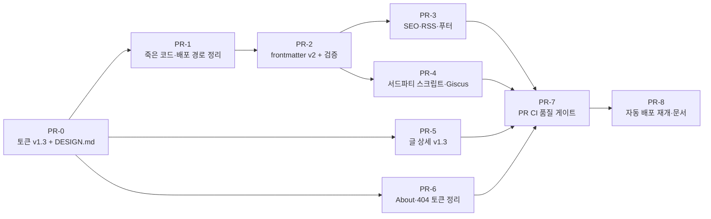

# Phase 0 안정화 (배포 재개 전 정리)

> PRD-001 로드맵 Phase 0의 실행 기획서. 자동 배포를 다시 켜기 전에 끝내야 할 작업을 PR 단위로 정한다. 디자인 기준은 `cowork/design/` v1.3(+ `10-planning-decisions.md`의 D1~D4)이다.

## 1. 목표

**자동 배포를 다시 켰을 때 라이브 사이트의 모든 페이지가 새 디자인 토큰을 쓰고, 공유·검색·배포가 깨지지 않는 상태를 만든다.**

### 완료 조건 (Phase 0 게이트)

| # | 조건 | 확인 방법 |
| --- | --- | --- |
| G0-1 | `src/`에 금지 패턴(`gray-` `sky-` `zinc-` `blue-` `dark:` 색 클래스, hex 값) 0건. `globals.css` 제외 | CI grep (PR-7) |
| G0-2 | 홈·글 상세·About Lighthouse SEO 100, 접근성 ≥ 95 (모바일) | Lighthouse, 배포 후 |
| G0-3 | 모든 글 URL의 og:image가 실제 파일을 가리킴, Rich Results Test에서 `BlogPosting` 오류 0 | CI 스크립트 + 수동 1회 |
| G0-4 | `/rss.xml`이 W3C Feed Validator 통과 | 수동 1회 + CI XML 파싱 |
| G0-5 | frontmatter 규칙 위반 시 `yarn build`가 실패 | 깨진 fixture로 확인 |
| G0-6 | main 머지 후 10분 안에 라이브 반영, PR에서 lint·build 실패 시 머지 차단 | Actions 기록 |

## 2. 현재 상태 (2026-10-27, 커밋 `2a73cae` 기준)

PRD-001 작성 이후 이미 끝난 것과 남은 것을 나눈다.

### 이미 완료 (Phase 0 범위에서 제외)

| 항목 | PRD-001 | 위치 |
| --- | --- | --- |
| OG 이미지 URL에 `/images/posts/thumbnails/` 경로 반영 | P1 | `posts/[id]/page.tsx` |
| 글 상세 토큰 마이그레이션 (#15) | P11, F-PO-02 | `posts/[id]/page.tsx` |
| 제목 앵커(rehype-slug + autolink-headings) | F-PO-02 | `lib/posts.ts` |
| 목차 TOC (xl 이상 sticky, IntersectionObserver) | F-PO-03 일부 | `PostToc.tsx` |
| 코드 복사 버튼 | F-PO-04 일부 | `PostContent.tsx` |
| 읽기 시간, 이전/다음 글 | F-PO-01·05 | `lib/posts.ts` |
| `package.json`의 `deploy` 스크립트 삭제 | P3 | **작업 트리에만 있고 미커밋** → PR-1에서 커밋 |

### 남은 문제

| 문제 | 근거 | PR |
| --- | --- | --- |
| About·Bio·ExperienceItem·ActivityCard·not-found에 금지 패턴 92건 (about 52, Bio 12, ExperienceItem 10, ActivityCard 10, not-found 8) | G0-1 | PR-6 |
| 사용하지 않는 `SearchModal.tsx`(금지 패턴 6건 포함), `src/api/posts/route.ts`, `gh-pages` 의존성 | P3·P4 | PR-1 |
| frontmatter가 `categories`(배열)이고 검증 없음, 초안 글 구분 없음 | 6.1, F-SE-07·08 | PR-2 |
| `operator-lifecycle-manager.md`가 미추적 상태이고 karpenter 글의 메타를 복사함 | P5 | PR-2 |
| `metadataBase`·canonical·JSON-LD·RSS 없음, sitemap 홈·About `lastModified`가 빌드 시각 | P7·P10 | PR-3 |
| 푸터 링크가 GitHub 하나 | F-GL-03 | PR-3 |
| AdSense가 전 페이지에 로드, GoatCounter가 일반 `<script async>` | F-SE-09, NF-01 | PR-4 |
| Giscus `theme="dark"` 고정(라이트 모드에서도 다크) | P6, F-PO-08 | PR-4 |
| 글 상세 헤더·경로·저자 박스가 v1.3 시안과 다름 | 디자인 v1.3 | PR-5 |
| 토큰이 v1.3 시안보다 적음(`line-strong`, `warn`, `overlay`, `code-hl`, 타입·폭 토큰 없음) | 디자인 04 | PR-0 |
| PR CI 없음, 자동 배포 꺼짐 | P2·P13 | PR-7·8 |

## 3. 범위

### 포함

| 영역 | 내용 |
| --- | --- |
| 디자인 시스템 | v1.3 토큰을 `globals.css`로 이전, `/DESIGN.md` 갱신 |
| 정리 | 죽은 코드·의존성 제거, 배포 경로를 GitHub Actions 하나로 |
| 콘텐츠 | frontmatter v2(단일 `category`, `draft`, `updated`, `series`), 검증, 기존 15편 이전 |
| SEO | 메타데이터, JSON-LD, RSS, sitemap, 푸터 링크 |
| 서드파티 | AdSense 제거, GoatCounter 지연 로드, Giscus 테마 동기화 |
| 화면 | 글 상세를 v1.3 시안에 맞춤, About·404·관련 컴포넌트 토큰 정리(About은 구조 유지) |
| 품질·배포 | PR CI, 자동 배포 재개, 문서 갱신 |

### 제외 (다음 Phase)

| 항목 | Phase | 이유 |
| --- | --- | --- |
| 모바일 목차·시리즈 한 줄 바, 시리즈 박스, 코드 블록 파일명·줄 하이라이트, 관련 글, 콜아웃, 라이트박스, 진행률 | 1 | 읽기 경험 단계 |
| 이미지 WebP 변환, OG 이미지 자동 생성(목록 썸네일 겸용) | 1 | 이미지 파이프라인 단계 |
| 홈 필터의 URL 쿼리 연동(`?category=`) | 1 | 홈 구조 변경과 함께 |
| `/projects`, About 재구성(요약 우선·데이터 분리), 이력서 PDF, 홈 featured | 2 | 포트폴리오 단계 |
| ⌘K 팔레트, 태그 페이지, 헤더 검색 버튼 | 3 | 탐색 단계 |
| 헤더 `projects` 메뉴 | 2 | 페이지가 생길 때 추가. 그 전엔 `posts`·`about`만 |
| MDX 전환 | 결정 보류 | PRD-001 8.2 |

## 4. 디자인 시안 사용 범위

구현자는 아래 표의 "Phase 0" 열만 시안에서 가져온다.

| 시안 | Phase 0에서 쓰는 것 | 나중에 쓰는 것 |
| --- | --- | --- |
| `system/tokens.css` | 색(신규 4개 포함), 타입 스케일, 폭(`w-read` 720, `w-container` 1120), `tap` 44, 모션 | 간격 토큰은 Tailwind 기본 4px 스케일과 같으므로 이전하지 않음 |
| `system/components.css` | `path`, `post-head`, `author`, `pager`, `comments`, `site-footer`, `prose` 세부값 | `toc-inline`, `series`, `code` 파일명 바, `callout`, `palette`, `lightbox`, `proj-item`, `timeline` 등 |
| `system/giscus-dark.css` · `giscus-light.css` | 그대로 `public/giscus/`로 복사 | |
| `site/post.html` | 상단 경로, 헤더 메타 순서, 저자 박스, 이전/다음, 댓글 영역 | 도구 줄(목차·시리즈), 관련 글, 콜아웃 |
| `site/404.html` | 전체(작은 화면이라 그대로 구현) | 검색 버튼은 Phase 3 전까지 숨김 |
| `site/about.html` | 색·글자 토큰, 직함 문구(D4) | 레이아웃(요약 우선, 타임라인), 화살표 링크 |
| `site/index.html` | 카테고리 칩 이름·순서(D1) | 히어로 v1.3, featured, 사이드 열 |

## 5. 작업 목록 (PR 단위)

순서: PR-0 → PR-1 → PR-2 → (PR-3 · PR-4 · PR-5 · PR-6 병렬 가능) → PR-7 → PR-8

### PR-0. 디자인 토큰 v1.3 이전 + DESIGN.md 갱신

| 항목 | 내용 |
| --- | --- |
| 변경 파일 | `src/app/globals.css`, `DESIGN.md` |
| 작업 | 1) `cowork/design/system/tokens.css`의 신규 색 토큰 `line-strong`, `warn`, `overlay`, `code-hl`, `accent-soft`, `code-bar`, `code-line`을 `:root`·`.dark`에 추가 2) `@theme inline`에 `--color-line-strong`, `--color-warn` 등 매핑 추가(유틸리티 이름 `border-line-strong`, `text-warn`) 3) 타입 스케일(`--text-*`), 폭(`--w-read`, `--w-container`), `--tap`, `--dur`·`--ease`를 추가 4) 반경 이름은 기존 `--radius-sm/md/lg`를 유지(시안의 `--r-*`은 같은 값) 5) `--syntax-comment`를 v1.1 값 `#7f9a8c`로 6) `DESIGN.md`를 `cowork/design/04-design-system.md` 기준으로 갱신: 시그니처 5가지, 원칙 6개(원칙 4에 "회사 성과와 개인 실습 글을 섞지 않음" 포함), 금지 패턴에 "본문 강조에 accent 금지", "관련 글은 시리즈·pager와 중복 금지" 추가 |
| 하지 않는 것 | 컴포넌트 수정 없음. 기존 유틸리티 이름(`bg-canvas`, `text-fg` 등) 변경 없음 |
| 수용 기준 | `yarn build` 성공, 홈·글 상세 화면이 PR 전과 시각적으로 같음(토큰 추가만), `DESIGN.md`의 토큰 표가 `globals.css`와 일치 |

### PR-1. 죽은 코드·배포 경로 정리

| 항목 | 내용 |
| --- | --- |
| 변경 파일 | `src/components/SearchModal.tsx`(삭제), `src/api/`(삭제), `package.json`, `yarn.lock`, `CLAUDE.md`, `README.md` |
| 작업 | 1) `SearchModal.tsx`, `src/api/posts/route.ts` 삭제 2) 작업 트리의 `deploy` 스크립트 삭제를 커밋하고 `gh-pages` 의존성 제거 3) `CLAUDE.md`의 Commands·Tech Stack·Deployment Workflow에서 `yarn deploy`·gh-pages 설명을 GitHub Actions 방식으로 교체, Directory Structure에서 `api/` 삭제 4) `README.md`를 create-next-app 기본값에서 사이트 소개 + 개발·배포 방법으로 교체(글 작성 가이드는 PR-2에서 추가) |
| 수용 기준 | `grep -r "SearchModal\|gh-pages\|/api/posts" src package.json CLAUDE.md` 0건, `yarn build` 성공 |

### PR-2. frontmatter v2 + 검증 + 기존 글 이전

| 항목 | 내용 |
| --- | --- |
| 변경 파일 | `src/lib/posts.ts`(→ 필요 시 `src/lib/content/`로 분리), 신규 `src/lib/content/schema.ts`, 신규 `content/tags.yaml`·`content/series.yaml`, `posts/*.md` 15편, `PostsBlock.tsx`, `PostListItem.tsx`, 글 상세 메타 |
| 스키마 | PRD-001 6.1과 같다. 필수 `title`, `description`(80~160자 권장, 글마다 고유), `date`, `category`, `tags`. 선택 `updated`, `series`+`seriesOrder`, `thumbnail`, `draft`(기본 false), `relatedProject` |
| category | `infra / backend / frontend / oss / note` 중 하나. 이전 규칙: Bitnami·Kafbat 기여 글 → `oss`, `implement-my-site` → `frontend`, 회고 → `note`, 나머지 10편 → `infra` |
| tags | `content/tags.yaml`에 정규 태그와 별칭을 둔다(예: `kubernetes: [k8s]`, `iac: [IaC]`). 글에는 정규 태그만 쓰고 기존 별칭은 이전 시 바꾼다. 카테고리와 같은 이름의 태그(`infra`, `project`)는 지운다 |
| series | `content/series.yaml`에 `eks-from-scratch`(5편: EKS 구축 → Karpenter 개념 → Karpenter 설치 → Custom Networking → ENI 트러블슈팅), `cilium-on-eks`(3편: 개념 → 설치 → 트러블슈팅). 이 PR에서는 필드만 넣고 화면 표시는 Phase 1 |
| draft | `operator-lifecycle-manager.md`에 `draft: true`를 넣고 커밋한다(로컬 초안을 저장소에 보관). description·tags·thumbnail은 karpenter 글 복사본이므로 실제 내용으로 고치거나 비워 두고, draft 글은 고유성 검사에서 제외. 이미지 폴더도 함께 커밋 |
| draft 동작 | `process.env.NODE_ENV === "production"`이면 목록·상세 정적 생성·sitemap·RSS에서 제외. dev에서는 목록에 `draft` 표시와 함께 보임 |
| 검증 (zod) | 빌드 중 한 번 실행. 실패 시 파일명과 이유를 모아 출력하고 빌드 실패: 필수 필드 누락, 잘못된 category, 미등록 태그, 중복 description(draft 제외), 없는 썸네일 파일, 레지스트리에 없는 series, 한 시리즈 안에서 빠지거나 겹치는 seriesOrder |
| 화면 | 홈 칩은 `all · infra · backend · frontend · oss · note` 순서(D1), 글이 0편인 칩 숨김(현재 backend), 칩 옆 글 수 유지. 목록·글 상세 메타에 단일 category 표시 |
| 문서 | `README.md`에 글 작성 가이드: frontmatter 예시, 허용 category, 태그 추가 방법, 이미지 경로 규칙, draft 사용법 |
| 수용 기준 | 1) 15편 모두 새 스키마로 빌드 성공 2) 프로덕션 빌드 `out/`에 OLM 글 HTML 없음 3) 의도적으로 깨뜨린 fixture 3종(잘못된 category, 중복 description, 없는 썸네일)에서 빌드가 각각 실패 4) 홈 칩에 backend 없음, 나머지 수: infra 10 · frontend 1 · oss 2 · note 1 |

### PR-3. SEO·RSS·푸터

| 항목 | 내용 |
| --- | --- |
| 변경 파일 | `src/app/layout.tsx`, `posts/[id]/page.tsx`, `about/page.tsx`, `sitemap.ts`, 신규 `src/app/rss.xml/route.ts`, `Footer.tsx` |
| 메타데이터 | `metadataBase: new URL("https://comstering.github.io")`, title 템플릿 `%s · Comstering`(홈은 `Comstering's Dev Notes`), description을 DevOps·Cloud Native Engineer 기준 문장으로, 페이지별 `alternates.canonical`, `twitter: { card: "summary_large_image" }` |
| JSON-LD | 글 상세: `BlogPosting`(headline, description, datePublished, dateModified = `updated ?? date`, author = Person "최한수", image, url). About: `Person`(name, jobTitle "DevOps · Cloud Native Engineer", sameAs GitHub·LinkedIn). `<script type="application/ld+json">`로 서버 렌더 |
| RSS | `/rss.xml` route handler, `dynamic = "force-static"`. 최신순, draft 제외, 항목별 title·link·guid·pubDate·description. layout `alternates.types`에 `application/rss+xml` 등록 |
| sitemap | 글 `lastModified` = `updated ?? date`, 홈 = 최신 글 날짜, About = 고정 날짜 상수(About 데이터 수정 시 갱신). draft 제외 |
| 푸터 | v1.3 시안대로 `github · linkedin · email · rss` 4개 링크. 외부 링크는 `rel="noopener noreferrer"` + 스크린리더용 "새 창에서 열림" |
| 수용 기준 | G0-3, G0-4. `out/sitemap.xml`의 `lastModified`가 빌드를 두 번 해도 바뀌지 않음 |

### PR-4. 서드파티 스크립트·Giscus

| 항목 | 내용 |
| --- | --- |
| 변경 파일 | `src/app/layout.tsx`, `GiscusComment.tsx`, `ThemeToggle.tsx`(또는 테마 훅), 신규 `public/giscus/dark.css`·`light.css` |
| AdSense | layout의 AdSense `<script>` 삭제. `public/ads.txt`와 AdSense 계정은 유지(PRD-001 F-SE-09: 추후 재논의) |
| GoatCounter | `next/script` `strategy="lazyOnload"`로 교체. 조회수 표시(`ViewCounter`)는 그대로 |
| Giscus 테마 | 1) 시안의 `giscus-dark.css`·`giscus-light.css`를 `public/giscus/`로 복사 2) 초기 테마 = 현재 사이트 테마(`resolvedTheme`)에 맞춰 `https://comstering.github.io/giscus/{dark,light}.css` 3) 테마 토글 시 iframe에 `postMessage({ giscus: { setConfig: { theme } } }, "https://giscus.app")` 4) 커스텀 CSS는 배포된 URL에서만 읽히므로 dev(`localhost`)에서는 내장 `dark`·`light` 테마로 대체 |
| 수용 기준 | 1) 빌드 산출물 HTML에 `adsbygoogle` 0건 2) 라이트 모드에서 새로고침 없이 토글하면 1초 안에 댓글 영역 테마가 바뀜 3) 글 상세 초기 JS가 PR 전보다 늘지 않음(`next build` 출력 비교) |

### PR-5. 글 상세 v1.3 정렬

| 항목 | 내용 |
| --- | --- |
| 변경 파일 | `posts/[id]/page.tsx`, 필요 시 신규 `components/post/PostHeader.tsx`·`AuthorBox.tsx`·`PostPager.tsx` |
| 상단 경로 | `← posts` 링크를 시그니처 2번 `~/posts/<slug>` 경로로 교체(`~`, `posts`는 링크, 현재 위치는 `aria-current="page"`). `~` 링크 터치 영역 24px 이상 |
| 헤더 메타 | 순서를 시안대로 `category · date`(제목 위) → 제목 → 설명 → `N min read · views · updated`(제목 아래). `updated`는 frontmatter에 있을 때만 |
| 태그 | 헤더에서 글 끝(저자 박스 위)으로 이동. 태그 페이지가 없는 Phase 0에서는 링크 없이 텍스트 |
| 이전/다음 | 시안 `pager` 스타일(위 `prev ←` / `next →` 라벨, 제목). 동작은 현재 날짜 기준 유지 |
| 저자 박스 | 이름, `@comstering`, 한 줄 소개("개발과 운영의 경계를 좁히는 DevOps · Cloud Native Engineer"), `about →` 링크. 프로필 이미지 alt는 빈 값 유지(이름이 옆에 있음) |
| 댓글 | 시안 `comments` 영역(라벨 `comments` + Giscus). PR-4 테마 동기화와 같이 확인 |
| 하지 않는 것 | 모바일 목차·시리즈 바, 시리즈 박스, 관련 글, 코드 파일명 바(Phase 1) |
| 수용 기준 | 1280×720과 360×640에서 시안 `post.html`의 해당 영역과 비교 확인, 가로 스크롤 0, 페이지당 h1 1개 |

### PR-6. About·404·관련 컴포넌트 토큰 정리

| 항목 | 내용 |
| --- | --- |
| 변경 파일 | `about/page.tsx`, `Bio.tsx`, `ExperienceItem.tsx`, `ActivityCard.tsx`, `not-found.tsx` |
| About | **구조는 그대로 두고 색·글자·간격만** 토큰으로 바꾼다(재구성은 Phase 2). 금지 패턴 92건 → 0. 같이 고칠 콘텐츠: 1) CJ Olive Young 직함 `DevOps · Cloud Native Engineer` 2) Class101 직함 `Web Developer (backend 중심)` 3) Temporal 프로젝트 기간 오류 `2025.05 ~ 2026.03, 2026.01 ~ 2026.02` 정리(작성자 확인 후 하나로) 4) 소개 강조에 accent를 쓰지 않음 |
| 404 | 시안 `404.html` 그대로: 서버 컴포넌트로 전환(`"use client"` 제거, `history.back()` 버튼 삭제), 최신 글 3편(빌드 타임), 홈 링크. 검색 버튼은 Phase 3 전까지 숨김 |
| 수용 기준 | G0-1 전체 통과, About 화면 구성(섹션 순서·내용)이 PR 전과 같음 |

### PR-7. PR CI 품질 게이트

| 항목 | 내용 |
| --- | --- |
| 변경 파일 | 신규 `.github/workflows/ci.yaml`, 신규 `scripts/check-design-tokens.sh`, `scripts/check-build-output.mjs` |
| 단계 | `pull_request`에서 1) `yarn install --frozen-lockfile` 2) `yarn lint` 3) `yarn build`(PR-2 검증 포함) 4) 금지 패턴 검사: `src/`에서 `gray-|sky-|zinc-|blue-|dark:` 색 클래스와 hex 0건, 시안 전용 `class="ph"`·`ph-block` 0건 5) 산출물 검사: 모든 `out/posts/*.html`의 og:image 경로가 `out/`에 존재, `out/rss.xml` XML 파싱 성공·항목 수 = 발행 글 수, 산출물에 `adsbygoogle` 0건 |
| 사용자 작업 | GitHub 저장소 설정에서 main branch protection: CI 통과 필수 |
| 수용 기준 | 금지 패턴을 넣은 테스트 PR이 실패하고, 정상 PR은 3분 안에 통과 |

### PR-8. 자동 배포 재개 + 문서 갱신

| 항목 | 내용 |
| --- | --- |
| 변경 파일 | `.github/workflows/deploy.yaml`, `CONTEXT.md`, `CLAUDE.md` |
| 작업 | 1) `on.push.branches: [main]` 주석 해제, `workflow_dispatch` 유지 2) `CONTEXT.md`를 현재 상태로 갱신(글 수, 완료 기능, Phase 1 TODO, 알려진 이슈) 3) `CLAUDE.md`에 `cowork/prd`·`cowork/design` 위치와 "UI 작업 전 DESIGN.md, 기능 작업 전 해당 PRD 확인" 규칙 추가 |
| 배포 후 작업 | 1) Google Search Console·네이버 서치어드바이저에 sitemap 재제출 2) Rich Results Test로 글 1편 확인 3) LinkedIn Post Inspector로 OG 미리보기 확인 4) Lighthouse 3페이지(홈·글 상세·About) 측정 후 결과를 `CONTEXT.md`에 기록 |
| 수용 기준 | G0-2, G0-6 |

## 6. 리스크

| 리스크 | 대응 |
| --- | --- |
| category·태그 이전으로 기존 URL이 바뀜 | URL은 파일명(`/posts/[id]`) 기준이라 바뀌지 않는다. 파일명 변경 금지. Giscus `mapping="pathname"`도 그대로 |
| Giscus 커스텀 테마 CSS가 배포 전에는 확인 불가 | dev는 내장 테마로 대체. 배포 직후 라이트·다크 둘 다 확인을 PR-8 체크 항목에 포함 |
| About 콘텐츠 수정 중 사실 오류 | 직함·기간 외 문구는 바꾸지 않는다. 바꾸는 문구는 PR 설명에 전·후를 적고 작성자가 확인 |
| PR-2가 커서 리뷰가 어려움 | 필요하면 2a(스키마·검증·글 이전)와 2b(홈 칩·메타 화면)로 나눈다 |
| 배포 재개 직후 문제 | `workflow_dispatch`로 이전 커밋을 다시 배포할 수 있게 유지 |

## 7. 남은 결정

| # | 항목 | 기본안 |
| --- | --- | --- |
| 1 | Temporal 프로젝트 기간(`2025.05 ~ 2026.03, 2026.01 ~ 2026.02`)의 정확한 값 | 작성자 확인 필요. 확인 전에는 PR-6에서 수정하지 않는다 |
| 2 | `operator-lifecycle-manager` 글을 Phase 0에서 완성할지 | 기본은 `draft: true`로 커밋만. 완성은 일정 여유가 있을 때 |
| 3 | `agent-browser` CLI 설치 | 사용자 결정. 설치하면 PR-5·6 화면 확인을 스크립트로 반복할 수 있다 |
