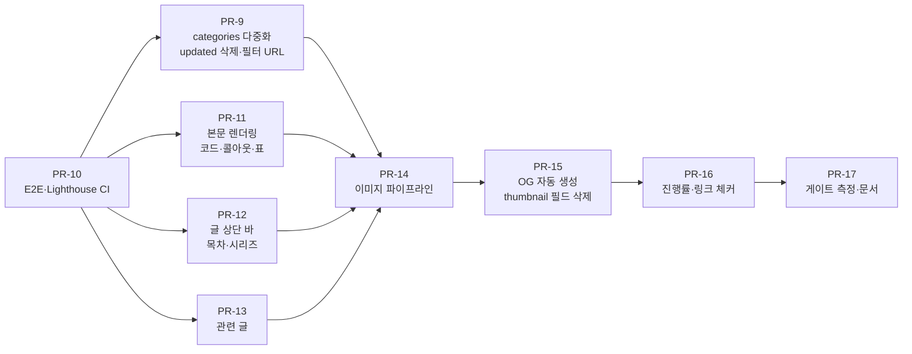

# Phase 1 읽기 경험 (글 상세·홈 탐색·이미지)

> PRD-001 로드맵 Phase 1의 실행 기획서. 검색으로 들어온 독자가 글 하나에서 답을 찾고, 다음 글까지 이어 읽게 만든다. 디자인 기준은 `cowork/design/` v1.3 시안이다.

## 0. 확정 요약 (2026-10-28, 기획·디자인·작성자 합의)

| 항목 | 최종 결정 |
| --- | --- |
| categories | 배열, 최대 2개, 대표 없음. 고정 순서 `infra · backend · frontend · oss · note`로 정렬해 `infra, oss`처럼 표시. 필터는 모든 값으로 걸림, 칩 숫자 유지 |
| 날짜 | 작성자가 적은 `date`만 사용. `updated` 필드 삭제 |
| 목록 썸네일 | 홈·태그 목록에서 제거. `thumbnail` 필드는 OG 자동 생성(PR-15) 뒤 삭제 |
| OG 이미지 | 글마다 빌드 시 자동 생성, PNG, 하단 `categories · 날짜 · 시리즈`, 강조선 없음 |
| 필터 URL | `?category=` + `router.push`(뒤로가기로 복원) |
| 본문 | 코드 블록 언어·파일명·줄 하이라이트·복사(`$ ` 제외), 콜아웃 note/warn, 표 흐림 가장자리, 이미지 확대는 화면보다 큰 이미지만 |
| 글 상단 | 1280 미만 목차·시리즈 한 줄 바, 1280 이상 sticky 목차, 시리즈 박스, 목차 없으면 본문 위치 유지 |
| 관련 글 | 태그 점수, 시리즈·이전/다음 글 제외, 최대 3편, 0편이면 숨김 |
| MDX | Phase 1에서는 도입하지 않음 |
| 개발 순서 | PR-10 → PR-9 → PR-11·12·13 → PR-14 → PR-15 → PR-16 → PR-17 |
| 디자인 기준 | `cowork/design/` v1.4 + 13번 R1(목록 썸네일 정리) |

## 1. 목표

**모바일 검색 유입 독자(J2)가 첫 화면에서 본문을 읽기 시작하고, 원하는 절로 바로 이동하고, 코드를 그대로 복사하고, 시리즈·관련 글로 두 번째 페이지까지 읽는다.**

### 완료 조건 (Phase 1 게이트)

| # | 조건 | 확인 방법 |
| --- | --- | --- |
| G1-1 | 홈·글 상세·About이 아래 "성능 측정 기준"의 **차단선** 통과(실제 Chrome 관측: 성능 ≥ 90, LCP ≤ 2.5s, CLS ≤ 0.1, TBT ≤ 300ms) | Lighthouse CI (PR-10), 3회 중앙값 |
| G1-2 | 접근성 100, SEO 100. **목표선**(성능 ≥ 95, LCP ≤ 2.0s, CLS ≤ 0.05, 모범사례 ≥ 95)은 측정해서 `CONTEXT.md`에 기록(미달이어도 게이트 실패 아님) | Lighthouse CI |
| G1-3 | E2E 시나리오 전부 통과: 목차 이동, 코드 복사, 시리즈 펼침, 필터 URL 연동, 이미지 확대 | Playwright (PR-10) |
| G1-4 | 360×640에서 모든 글의 **첫 본문 블록(첫 문단 또는 첫 h2)**이 첫 화면 안(≤ 640px)에서 시작함. 제목이 가장 긴 글로 측정 (2026-10-29 Q6: 첫 h2 앞에 서문이 있는 글은 서문이 곧 본문이므로 기준을 본문 시작으로 바꿈) | E2E 측정 |
| G1-5 | `public/images` 원본 대신 변환본 제공, 본문 이미지 ≤ 200KB | 빌드 산출물 검사 |
| G1-6 | 모든 글에 고유 OG 이미지(PNG). 홈·태그 목록에는 썸네일 없음 | 빌드 산출물 검사 |

### 성능 측정 기준 (2026-10-30 Q12로 재결정, Phase 1 이후 모든 Phase 공통)

**측정 방식: 실제 Chrome 관측.** Lighthouse CI, 모바일 프리셋, `throttlingMethod: "devtools"`(느린 4G 수준 네트워크·CPU 4배 제한을 실제로 걸고 관측), 리눅스 CI 러너, 페이지마다 **3회 측정 중앙값**(`aggregationMethod: "median-run"`). 대상: 홈·글 상세·About(+ Phase별 추가 페이지).

| 등급 | 의미 | 성능 | LCP | CLS | TBT | 접근성 / SEO | 모범사례 |
| --- | --- | --- | --- | --- | --- | --- | --- |
| **차단 (error)** | 넘으면 PR 머지 불가. 회귀 방지선 | ≥ 90 | ≤ 2.5s | ≤ 0.1 | ≤ 300ms | 100 / 100 | — |
| **목표 (warn)** | PR 댓글에 경고 | ≥ 95 | ≤ 2.0s | ≤ 0.05 | ≤ 200ms | — | ≥ 95 (`is-on-https` 제외) |

- **관측으로 바꾼 이유 (Q11 결정 정정):** 처음엔 Lighthouse 기본 "시뮬레이션"을 기준으로 정했다. 그런데 시뮬레이션은 한 번 잰 결과로 느린 망을 계산하는 모델이라 웹 글꼴 바이트를 LCP에 그대로 더한다(개발 실험: 글꼴만 빼도 LCP 4.5s → 2.5s). 같은 사이트를 실제로 제한된 망에서 관측하면 LCP 1.84~1.92s, 성능 98이다(개발 브리프 `develop/briefs/Q11-performance-gate.md`). 디자인 19번의 에뮬레이션 측정도 관측 계열이다. 독자가 겪는 시간에 가까운 쪽을 기준으로 한다.
- **차단선 근거:** LCP 2.5s는 Google Core Web Vitals "good" 기준이다. 현재 관측값 1.9s에서 CI 러너 흔들림을 흡수할 여유(약 0.6s)를 둔다. 처음 숫자(LCP 2.0s, 성능 95)는 목표선으로 유지한다.
- **CI 안정성 확인:** 관측 방식은 리눅스 CI에서 아직 측정하지 않았다. 적용 PR에서 2회 이상 실행해 페이지별 LCP 흔들림을 기록한다. 흔들림이 ±0.3s를 넘으면 기획에 다시 묻는다.
- **CLS:** 차단 ≤ 0.1은 PR-17부터. 시뮬레이션에서 About 0.125였다(한글 웹 글꼴 도착 후 줄바꿈). 글꼴 서브셋 PR 뒤 관측 측정으로 다시 확인한다.
- **모범사례:** 측정 대상이 `http://localhost`라 `is-on-https`가 항상 실패한다. 이 감사를 빼고 본다(`skipAudits`). 실서비스는 HTTPS.
- 시뮬레이션 측정과 데스크톱 프리셋은 게이트에서 뺀다(Q11 결정의 데스크톱 참고선 폐기).
- 차단선은 Phase 1 게이트(PR-17)부터 `error`. 그 전까지 `warn`. 넘으면 기준을 조용히 낮추지 않고 기획에 묻는다.
- **예외 (Q13, 2026-10-31):** About은 CI 관측에서 TBT 344~376ms, 성능 88~90으로 차단선에 걸린다(원인: 긴 문서 자체의 스타일·레이아웃 작업). 디자인 영향 없는 작은 개선을 먼저 하고, 그래도 넘으면 **About의 성능·TBT만** PR-17에서 `warn`으로 둔다. 숫자는 낮추지 않는다. 예외는 About을 다시 만드는 Phase 2 PR-19까지이고, PR-19에서 차단선을 통과하면 해제한다(PRD-004).
- 실사용 기준(Core Web Vitals 75퍼센타일)은 Search Console에 데이터가 생기면 분기마다 보는 참고 지표.

## 2. 현재 상태 (Phase 0 완료, 커밋 `208a23e` 기준)

| 항목 | 상태 | Phase 1 작업 |
| --- | --- | --- |
| 목차 | xl(≥1280) 오른쪽 sticky만 있음 | 1280 미만 한 줄 바 추가, 현재 항목 굵기 |
| 코드 블록 | 복사 버튼만 있음 | 언어 라벨, 파일명, 줄 하이라이트 |
| 이전/다음 | 날짜 기준 동작 | 유지 |
| 시리즈 | `content/series.yaml`과 frontmatter 필드만 있음(화면 없음) | 시리즈 박스·목록 메타 표시 |
| 관련 글 | 없음 | 신규 |
| category | 단일 `category` (infra 11 · oss 2 · frontend 1 · note 1, draft 포함) | **다중 `categories`로 변경 (4장)** |
| 홈 필터 | 컴포넌트 상태로만 동작 | URL 쿼리 연동 |
| 이미지 | 원본 그대로, `public/images` 29MB, 300KB 넘는 파일 38개 | 변환·크기 명시·지연 로드·확대 |
| 썸네일 | 글마다 수동 지정한 기술 로고, 같은 이미지 재사용, 원본 비율·배경·톤 제각각(디자인 09 V1·14번). og:image로도 쓰임 | 목록에서 제거, og:image는 자동 생성으로 교체 |
| Giscus 테마 동기화 | Phase 0에서 완료 | 없음 |
| 테스트 | lint·build·산출물 검사만 | E2E, Lighthouse CI 추가 |

## 3. 범위

### 포함

| 영역 | 기능 (PRD-001 ID) |
| --- | --- |
| 홈 탐색 | 다중 categories(신규), 필터 URL 연동 F-HM-04 |
| 글 상단 | 1280 미만 목차·시리즈 한 줄 바 F-PO-03, 시리즈 박스 F-PO-07 |
| 본문 | 코드 블록 F-PO-04, 콜아웃 F-PO-12, 표 가로 스크롤 표시(디자인 08 L2), 이미지 F-PO-11 |
| 글 끝 | 관련 글 F-PO-06 |
| 이미지·OG | 이미지 파이프라인 NF-02, OG 자동 생성 F-SE-02, 목록 썸네일 제거 |
| 부가 | 읽기 진행률 F-PO-10 |
| 품질 | E2E, Lighthouse CI, 링크 체커(백로그) |

### 제외

| 항목 | 단계 |
| --- | --- |
| `/projects`, About 재구성, 이력서, 홈 featured·히어로 v1.3 | Phase 2 |
| ⌘K 팔레트, 태그 페이지, 헤더 검색 버튼 | Phase 3 |
| MDX 전환 | **Phase 1에서는 하지 않는다.** 코드 파일명·줄 하이라이트·콜아웃은 remark/rehype 플러그인으로 충분하다. 본문에 React 컴포넌트가 필요해지는 시점(Phase 2 다이어그램)에 다시 판단 |

## 4. categories 다중화 (확정: B안)

**확정 (2026-10-28):** `categories`는 배열, **최대 2개, 대표 없음(B안).** 표시는 고정 순서 `infra · backend · frontend · oss · note`로 정렬하고 쉼표로 묶어 한 덩어리로 보인다(`infra, oss`). 디자인 12번 답변의 실측(360px 메타 줄 최악 조합 312/320px, OG 하단 780/1040px)으로 A안의 장점인 공간 절약이 필요 없다는 것이 확인되어, 기획 기본안(A안)을 B안으로 바꿨다. 아래 A·B 비교는 결정 기록으로 남긴다.

### 확정 표시 규칙 (디자인 12번)

| 자리 | 표시 |
| --- | --- |
| 홈·태그 목록 메타 | `<span class="cat">infra, oss</span>` 한 요소, `fg` |
| 글 상세 헤더 | 값마다 `/?category=<값>` 링크(accent), 쉼표는 `mute`·링크 밖·`aria-hidden` |
| OG 하단 줄 | `infra, oss`(accent) → 날짜 → 시리즈 |
| RSS / JSON-LD | `<category>` 여러 개 / `articleSection` 배열 |
| 칩 숫자 | 그대로 둔다. 칩마다 "누르면 나오는 글 수"이고 실제 결과 수와 일치. 합이 전체 수와 달라도 됨 |

### 공통 (A·B 모두)

```yaml
categories: [oss, infra]   # 1~2개, 허용 값만, 중복 금지
```

- 홈 필터는 모든 값을 쓴다. `infra` 칩을 누르면 `[oss, infra]` 글도 나온다.
- 칩 옆 글 수는 그 카테고리를 가진 글 수다. 겹치므로 칩 숫자 합이 전체 글 수보다 클 수 있다(`all` 칩만 전체 수).
- 2개로 막는 이유: 제한이 없으면 Phase 0 이전의 `[project, infra, backend]`처럼 카테고리가 태그와 구분되지 않는다. 세부 주제는 태그가 맡는다.
- 다중이 필요한 이유: Bitnami Helm 기여는 오픈소스이면서 인프라 작업, Kafbat 기여는 오픈소스이면서 UI(frontend) 수정이다. 단일 값이면 `infra` 필터에서 Bitnami 글이 빠진다.
- 검증(F-SE-07 갱신): 1~2개, 중복 금지, 허용 값만. 단수 `category` 필드가 남아 있으면 빌드 실패.

### 대표 카테고리가 필요한 경우는 어디인가

값이 하나만 들어가야 하는 자리가 있는지 확인했다. **기술적으로 꼭 하나여야 하는 자리는 없다.** RSS는 `<category>`를 여러 개 넣을 수 있고, JSON-LD `articleSection`도 배열을 받는다. 대표가 필요하다면 이유는 **화면 공간과 위계**다.

| 자리 | 하나여야 하나 | 설명 |
| --- | --- | --- |
| 홈 목록 메타 줄 | 아니오, 공간 문제 | `2025-08-13 · oss · infra · series eks 3/5`까지 가면 360px에서 줄이 길어진다 |
| 글 상세 헤더 | 아니오, 위계 문제 | 두 값을 같은 accent로 두면 강조가 두 개가 된다(원칙 2 "포인트 색 하나") |
| OG 이미지 하단 | 아니오, 공간 문제 | 1200×630 하단 한 줄에 category·날짜·시리즈가 같이 들어간다 |
| RSS, JSON-LD, 필터 | 아니오 | 여러 값 그대로 쓰면 된다 |

### A안. 대표 있음 (기획 기본안)

**첫 번째 값이 대표다.** 작성자가 순서로 대표를 정한다.

| 자리 | 표시 |
| --- | --- |
| 홈 목록 메타 | 대표 1개만: `2025-08-13 · oss` |
| 글 상세 헤더 | 대표는 accent, 두 번째는 mute: `oss infra · 2025-08-13` |
| OG 이미지 | 대표 1개 |
| RSS, JSON-LD | 전부 |

- 장점: 목록 한 줄이 지금과 같은 길이로 유지된다. 글 상세에서 무엇이 주된 성격인지 보인다.
- 단점: "배열의 첫 번째가 대표"라는 규칙을 작성자가 기억해야 한다. 목록에서는 두 번째 카테고리가 보이지 않아, `infra`로 필터했는데 메타에는 `oss`만 보이는 글이 섞인다.

### B안. 대표 없음

**모든 값을 동등하게 쓴다.** 표시 순서는 작성자 순서가 아니라 고정 순서(`infra · backend · frontend · oss · note`)로 정렬해 글마다 들쭉날쭉하지 않게 한다.

| 자리 | 표시 |
| --- | --- |
| 홈 목록 메타 | 전부: `2025-08-13 · infra · oss` |
| 글 상세 헤더 | 전부, 같은 스타일(둘 다 accent가 아니라 둘 다 mute, 또는 칩) |
| OG 이미지 | 전부(최대 2개라 한 줄에 들어감) |
| RSS, JSON-LD | 전부 |

- 장점: 규칙이 단순하다(순서 의미 없음). 필터 결과와 메타 표시가 항상 일치한다.
- 단점: 목록 메타 줄이 길어지는 글이 생긴다(현재 기준 2편). 글 상세 헤더에서 category를 accent로 강조하는 지금 스타일을 바꿔야 한다.

### 디자인에 물었던 것 (답변: `cowork/design/12-phase1-design-response.md`)

1. 360px 홈 목록에서 `날짜 · category 2개 · series` 메타 줄이 한 줄에 들어가는가, 줄바꿈되면 괜찮은가
2. 글 상세 헤더의 category 표시: A안(대표 accent + 두 번째 mute) vs B안(동등 표시) 중 어느 쪽이 원칙 2와 위계에 맞는가
3. OG 이미지 하단 줄에 category 2개가 들어갈 공간이 있는가
4. 위 답을 바탕으로 A안·B안 추천

답변: 1) 한 줄에 들어감 2) B안, 둘 다 필터 링크이므로 accent가 규칙과 맞음 3) 공간 넉넉함 4) B안 추천. **기획 채택.**

### 기존 글 이전안 (A·B 공통)

| 글 | 현재 | 변경 |
| --- | --- | --- |
| bitnami-helm-chart-contribute | oss | `[oss, infra]` |
| first-contribute-opensource (Kafbat UI) | oss | `[oss, frontend]` |
| 나머지 13편 | 단일 | 그대로 한 개짜리 배열 |

표시는 고정 순서를 따르므로 배열 순서는 의미가 없다.

## 4.1 `updated` 필드 삭제 (확정)

**글 날짜는 작성자가 `.md`에 직접 적은 `date` 하나만 쓴다.** `updated`는 쓰지 않고, Git 커밋 날짜로 수정일을 자동 계산하지도 않는다. 현재 `updated`를 쓰는 글은 0편이라 코드 정리만 하면 된다(PR-9).

| 위치 | 변경 |
| --- | --- |
| `content/schema.ts` | `updated` 필드 삭제(strictObject라 남아 있으면 빌드 실패) |
| `post/PostHeader.tsx` | `updated` 표시 삭제 |
| `posts/[id]/page.tsx` | OG `modifiedTime`, JSON-LD `dateModified` = `date` |
| `sitemap.ts`, `rss.xml/route.ts` | `updated ?? date` → `date` |
| PRD-001 | 6.1 스키마, F-PO-01, F-SE-03·05에서 `updated` 삭제 |
| 디자인 시안 | `post.html` 헤더의 `updated 2025-07-12` 삭제 요청 |

## 5. 작업 목록 (PR 단위)

순서: PR-10 → (PR-9 · PR-11 · PR-12 · PR-13 병렬) → PR-14 → PR-15 → PR-16 → PR-17

PR-10(테스트 기반)을 먼저 한다. 이후 PR마다 E2E 시나리오를 하나씩 붙여 게이트(G1-3)를 PR 단위로 채운다. 4장이 확정되어 PR-9는 PR-10 직후 바로 시작할 수 있다.



### PR-9. categories 다중화 + `updated` 삭제 + 필터 URL 연동 + 목록 썸네일 제거

| 항목 | 내용 |
| --- | --- |
| 전제 | 4장 B안 확정 |
| 변경 파일 | `src/lib/content/schema.ts`, `src/lib/posts.ts`, `PostsBlock.tsx`, `PostListItem.tsx`, `post/PostHeader.tsx`, `posts/[id]/page.tsx`, `sitemap.ts`, `rss.xml/route.ts`, `posts/*.md`, `README.md` |
| 스키마 | `category` → `categories: z.array(z.enum(CATEGORIES)).min(1).max(2)`, 중복 금지. 로드할 때 고정 순서(`CATEGORIES` 순)로 정렬해 저장한다(`primaryCategory` 없음). `updated` 필드 삭제(4.1). `content/series.yaml`의 `label`은 8자 이하(디자인 E8: 360px 메타 줄 여유 확보) |
| 화면 | 필터는 `categories.includes(selected)`. 메타·헤더 표시는 4장 확정 표시 규칙. RSS `<category>` 여러 개, JSON-LD `articleSection` 배열. 칩 순서·0편 숨김 규칙은 Phase 0 그대로 |
| 목록 썸네일 | 홈·태그 목록(`PostListItem`)에서 썸네일 열 삭제(디자인 12번 3장, 14번 C안). frontmatter `thumbnail`은 **PR-15까지 og:image로 쓰이므로 이 PR에서는 지우지 않는다** |
| URL 연동 | 선택 칩을 `?category=infra`로 반영. **`router.push(url, { scroll: false })`로 방문 기록을 남긴다**(디자인 E1: replace면 뒤로가기 복원이 안 됨). `all`이면 쿼리 없음. 첫 렌더에서 `searchParams`로 초기값을 파생하고 effect로 동기화하지 않는다. 정적 export라 `useSearchParams`를 쓰는 컴포넌트는 `<Suspense>`로 감싼다. 잘못된 값(`?category=xyz`)은 `all`로 |
| 수용 기준 | 1) `/?category=infra`로 직접 들어가면 infra 칩 선택 상태로 렌더되고 Bitnami 글이 포함됨 2) 칩 전환 후 뒤로가기로 이전 필터 복원 3) `category` 단수 필드나 `updated` 필드를 남긴 fixture, 9자 이상 series `label`에서 빌드 실패 4) 산출물에 `updated` 표시 0건 5) 홈 목록 이미지 요청 0건 6) 칩 5개 모두 칩 숫자 = 실제 결과 수 |

### PR-10. E2E·Lighthouse CI 기반

| 항목 | 내용 |
| --- | --- |
| 변경 파일 | 신규 `e2e/*.spec.ts`, `playwright.config.ts`, `lighthouserc.json`, `.github/workflows/ci.yaml`, `package.json` |
| E2E | Playwright. CI에서 `yarn build` 후 `out/`을 정적 서버로 띄워 실행. 뷰포트 1280×720, 360×640 두 개. 이 PR에서 넣는 시나리오: 홈 필터 URL 연동(PR-9), 테마 토글, 404 |
| Lighthouse CI | `@lhci/cli`로 `out/` 대상, URL 3개(홈, 이미지가 가장 많은 글, About), 모바일 프리셋. 기준: 성능 ≥ 95, 접근성 100, SEO 100, LCP ≤ 2000ms, CLS ≤ 0.05. **처음에는 경고(warn)로 시작**하고, PR-14 이미지 작업 후 실패(error)로 올린다 |
| 수용 기준 | PR마다 E2E 결과와 Lighthouse 리포트가 CI에 남음, 전체 CI ≤ 6분 |

### PR-11. 본문 렌더링: 코드 블록·콜아웃·표

| 항목 | 내용 |
| --- | --- |
| 변경 파일 | `src/lib/posts.ts`(파이프라인), 신규 `src/lib/content/rehype-code-meta.ts`, `PostContent.tsx`, `globals.css` |
| 코드 블록 | 코드 펜스 meta를 읽는다: ```` ```yaml title="values.yaml" {3,5-6} ````. 1) 상단 바: 언어 라벨(펜스 언어), 파일명(`title`이 있을 때), 복사 버튼 2) `{3,5-6}` 줄에 `code-hl` 배경 3) 줄바꿈 없이 가로 스크롤 4) 복사 내용은 원문 그대로(하이라이트 마크업·줄 번호 제외). 단 `bash`·`sh`·`shell`·`console` 블록은 줄 맨 앞 `$ `를 빼고 복사한다(화면에는 남김, 디자인 E2). 시안 `components.css`의 `code` 블록 기준 |
| 콜아웃 | GitHub 문법 `> [!NOTE]`, `> [!WARNING]` 지원(`note`·`warn` 두 종류). 시안 v1.1 기준: 1px 틴트 테두리 + 아이콘 라벨, 굵은 측면선 금지. 색은 `accent-soft`·`warn` 토큰 |
| 표 | 가로 스크롤 표 오른쪽에 흐림 가장자리(디자인 08 L2, 배경 `local` 방식, 그림자 없음) |
| 기존 글 | 기능 확인용으로 `custom-networking-karpenter-eni-troubleshooting.md`의 `values.yaml` 코드 블록에 파일명·줄 하이라이트를 적용한다. **다른 기존 글에는 콜아웃·셸 프롬프트·파일명을 소급 적용하지 않는다**(2026-10-29 Q4). 새 글과, 작성자가 내용을 고치는 글에만 쓴다 |
| 수용 기준 | E2E: 복사한 클립보드 내용이 원문과 일치(`$ ` 프롬프트 블록은 프롬프트 제외), 키보드로 복사 버튼 접근. 기존 15편 렌더 결과에서 코드 블록 깨짐 0 |

### PR-12. 글 상단 바: 목차·시리즈

| 항목 | 내용 |
| --- | --- |
| 변경 파일 | `posts/[id]/page.tsx`, `PostToc.tsx`, 신규 `post/PostToolbar.tsx`·`SeriesBox.tsx` |
| 1280 이상 | 지금처럼 오른쪽 sticky 목차. 현재 항목에 `font-weight 600`(디자인 08 참고). 시리즈 글이면 본문 위에 접힌 시리즈 박스 한 줄: `eks-from-scratch 5/5 · 현재 글 제목` |
| 1280 미만 | 목차와 시리즈를 **한 줄 두 버튼**(`contents 8` · `series eks 5/5`)으로 합친다(디자인 08 H1). 둘 다 네이티브 `<details>`로 만들어 JS 없이 열고 닫는다. 연 쪽이 한 줄을 다 쓰고 다른 쪽은 아래로 내려간다 |
| 목차 표시 조건 | h2가 3개 미만이면 목차 버튼과 sticky 목차를 숨긴다. 이때 1280 이상에서도 본문은 가운데로 옮기지 않고 같은 자리에 둔다(디자인 E7). 1280 미만에서 목차 버튼이 빠지면 시리즈 버튼이 한 줄 전체를 쓰고, 둘 다 없으면 도구 줄을 렌더하지 않는다 |
| 시리즈 박스 | `content/series.yaml`의 제목과 시리즈 글 목록(순서대로), 현재 글 강조(`aria-current`). 다음 편으로 가는 링크는 목록의 각 글 링크로 충족한다(따로 두지 않음, 디자인 17번 Q7) |
| 목록 메타 | 홈 목록에 `series eks 3/5`(레지스트리 `label` 사용) |
| 수용 기준 | G1-4. E2E: 목차 항목 클릭 시 제목이 헤더에 가려지지 않음(`scroll-margin-top` ≥ 헤더 높이 + 24px), URL 해시 변경. 시리즈 펼침 `aria-expanded` 전환 |

### PR-13. 관련 글

| 항목 | 내용 |
| --- | --- |
| 변경 파일 | `src/lib/posts.ts`, 신규 `post/RelatedPosts.tsx`, `posts/[id]/page.tsx` |
| 규칙 (F-PO-06) | 태그 교집합 수가 점수. 같은 점수면 최신순. **같은 시리즈 글과 이전/다음 글은 제외.** 점수 0인 글로 채우지 않는다. 최대 3편, 0편이면 섹션 숨김. draft 제외. 빌드 타임 계산 |
| 위치 | 이전/다음 아래, 댓글 위. 시안 `post-item--compact` 형식(meta → title → 설명 1줄) |
| 수용 기준 | 같은 글이 시리즈 박스·이전/다음·관련 글에 두 번 이상 나오지 않음(빌드 산출물 검사 또는 단위 테스트) |

### PR-14. 이미지 파이프라인

| 항목 | 내용 |
| --- | --- |
| 변경 파일 | 신규 `scripts/optimize-images.mjs`, 신규 `src/lib/content/rehype-images.ts`, `package.json`(`prebuild`), `.gitignore`, `PostContent.tsx` |
| 변환 | 빌드 전에 sharp로 `public/images/**`의 png·jpg를 WebP로 변환. 본문 이미지 최대 폭 1440px. **`public/images/posts/thumbnails/`는 변환하지 않는다**(목록에서 쓰지 않고, PR-15 전까지 og:image로 쓰이는데 일부 메신저가 WebP 미리보기를 못 읽음). 결과는 `public/_img/`(git 제외)에 두고 원본은 저장소에 유지. 입력 파일 해시로 캐시해 변경된 파일만 다시 변환(Actions 캐시 사용) |
| 본문 `` | rehype 플러그인이 1) `src`를 변환본으로 바꾸고 2) 실제 크기로 `width`·`height` 3) 첫 이미지를 제외하고 `loading="lazy"` `decoding="async"` 4) alt가 비어 있으면 빌드 경고(파일명 목록 출력) |
| 확대 | 네이티브 `<dialog>`(`showModal`) 라이트박스: Esc·바깥 클릭·44px 닫기 버튼, 닫으면 원래 이미지로 포커스 복귀, 캡션 표시, `prefers-reduced-motion`이면 애니메이션 없음. **원본 폭이 표시 폭(본문 720px)보다 큰 이미지에만** 붙인다(디자인 E3). rehype 단계에서 알게 된 `width`로 판단하고, 확대가 없는 이미지는 `cursor: zoom-in`과 버튼 역할을 주지 않는다 |
| 수용 기준 | G1-5. CLS ≤ 0.05. Lighthouse 경고를 실패로 전환(PR-10). E2E: 이미지 확대·닫기 |

### PR-15. OG 이미지 자동 생성

| 항목 | 내용 |
| --- | --- |
| 변경 파일 | 신규 `scripts/generate-og.mjs`(또는 `opengraph-image.tsx`), `posts/[id]/page.tsx` 메타데이터, `PostListItem.tsx`, `content/schema.ts` |
| 방식 | 먼저 Next.js `opengraph-image.tsx` + `generateStaticParams`가 정적 export에서 동작하는지 확인(PoC). 안 되면 satori + resvg 빌드 스크립트로 `public/_og/<slug>.png`를 만든다 |
| 디자인 | 시안 `og.html`·`og-render.html`: 1200×630, 다크 고정, 로고 `~/comstering_`, 제목 최대 3줄, 하단 `categories · 날짜 · 시리즈`. **아래 accent 선은 넣지 않는다**(디자인 E4: 로고 커서가 이미 accent 한 점) |
| 형식·글꼴 | og:image는 **PNG**(디자인 E5: 일부 메신저 미리보기가 WebP를 못 읽음, PoC 24~55KB). satori는 woff2를 읽지 못하므로 Pretendard 700·JetBrains Mono 400의 otf/ttf만 넣는다(E6). 한글은 제목에 쓰인 글자만 서브셋 |
| `thumbnail` 정리 | og:image가 자동 생성으로 바뀌면 `thumbnail`은 아무 곳에서도 쓰이지 않는다. 스키마에서 삭제하고(남아 있으면 빌드 실패), 15편 frontmatter에서 지운다. `public/images/posts/thumbnails/`는 본문에서 쓰지 않는 파일만 삭제 |
| 사이트 OG | 홈·About용 OG(시안 세 번째 샘플)도 같은 방식으로 생성 |
| 수용 기준 | G1-6. 모든 글 og:image가 고유 PNG, LinkedIn Post Inspector로 1편 확인, 스키마·글에 `thumbnail` 0건 |

### PR-16. 읽기 진행률·링크 체커

| 항목 | 내용 |
| --- | --- |
| 진행률 (F-PO-10) | 헤더 하단 2px accent 바. CSS scroll-driven animation(`animation-timeline: scroll()`), 지원하지 않는 브라우저에서는 표시하지 않는다(scroll 리스너 금지). `prefers-reduced-motion`이면 숨김 |
| 링크 체커 | lychee를 주 1회 스케줄과 PR(변경된 글만)에서 실행. 깨진 외부 링크는 실패가 아니라 이슈 생성 |
| 수용 기준 | 진행률이 scroll 리스너 없이 동작, lychee 첫 실행 결과의 깨진 링크 정리 |

### PR-17. 게이트 측정·문서

| 항목 | 내용 |
| --- | --- |
| 작업 | 1) G1-1~G1-6 측정 결과를 `CONTEXT.md`에 기록 2) `README.md` 글 작성 가이드에 categories 규칙, 코드 펜스 meta, 콜아웃 문법, 시리즈 등록 방법 추가 3) `DESIGN.md`에 Phase 1에서 구현한 컴포넌트 표시 4) PRD-001 7장 체크 |

## 6. 리스크

| 리스크 | 대응 |
| --- | --- |
| categories 다중화로 칩 숫자 합이 전체 글 수와 달라 혼란 | 디자인 검토 결과 유지. 칩 숫자 = 누르면 나오는 수로 일치하면 충분 |
| OG 자동 생성이 정적 export에서 막힘 | PR-15 첫 단계를 PoC로 두고, 막히면 빌드 스크립트로 전환 |
| 한글 글꼴 때문에 OG 생성이 느리거나 큼 | 제목 글자 서브셋, 결과 캐시 |
| 이미지 변환이 빌드 시간을 늘림 | 해시 캐시로 변경 파일만 변환, 빌드 시간 ≤ 3분(PRD-001 5.2) 유지 확인 |
| Lighthouse 점수가 CI 환경마다 흔들림 | 3회 측정 중앙값, 처음엔 경고로 시작 |
| 목록 썸네일 제거로 "어떤 기술인지 한눈에"가 데스크톱 목록에서 사라짐 | 썸네일의 목적 자체는 유효하다(디자인 14번). 대신 메타 줄(categories·시리즈)과 태그가 맡고, 모바일은 원래 썸네일을 숨겨 왔다. 나중에 같은 규격의 이미지를 만들 여유가 생기면 되돌릴 수 있다: Git에서 `thumbnail` 필드와 `PostListItem` 썸네일 열을 복구하고, 목록용 이미지 규격(비율·배경·로고 색)을 정해 새로 만든다 |

## 7. 결정 상태

| # | 항목 | 상태 |
| --- | --- | --- |
| 1 | categories 다중화 | **확정:** 배열, 최대 2개 |
| 2 | 대표 카테고리 유무 | **확정: B안(대표 없음).** 고정 순서로 정렬, 쉼표로 묶어 표시 (디자인 12번 추천, 2026-10-28) |
| 3 | 수정일 | **확정:** `updated` 필드 삭제. 작성자가 적은 `date`만 사용 (4.1) |
| 4 | 목록 썸네일 | **최종 확정: 목록에서 제거 (디자인 14번 C안, 2026-10-28).** 이유: 썸네일의 목적(어떤 기술인지 한눈에)은 유효하지만, 지금 이미지들은 원본 비율·배경·로고 색이 제각각이라 어두운 목록에 맞지 않고, CSS로는 통일되지 않는다(디자인 14번 3장 시험). 맞추려면 약 11장을 같은 규격으로 새로 만들어야 하는데 작성자가 그 비용을 들이지 않기로 했다. `thumbnail` 필드는 PR-15에서 삭제 (되돌리는 방법은 6장) |
