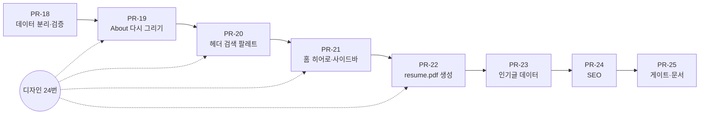

# Phase 2 포트폴리오 (About 강화·이력서 PDF·홈 블로그 정비·검색)

> PRD-001 로드맵 Phase 2의 실행 기획서. 파일명은 링크 유지를 위해 그대로 둔다. **사이트의 역할 분리:** 홈은 블로그, 경력·이력서·기술은 About에서 끝난다. About과 블로그 글은 서로 링크하지 않는다.

## 0. 확정 요약

| 항목 | 결정 |
| --- | --- |
| 역할 분리 | **홈 = 블로그, About = 경력·이력서·기술.** 홈에 이름·직함·기술 태그·성과·경력 링크를 두지 않는다. 상단바 `posts · about`이 About으로 가는 유일한 길 |
| About ↔ 블로그 | **서로 링크하지 않는다.** About은 회사 경력, 블로그는 개인 학습·프로젝트 기록이다. 블로그에 회사에서 배운 내용이 들어갈 수 있어도 대부분 개인 환경에서 다시 적용한 글이라, 회사 경력과 연결하면 회사 일처럼 읽힌다 |
| About | 데이터 파일 기반으로 다시 그린다. 경력은 **전부 펼침** + 회사별 바로가기. `what i do` 없음. 첫 화면에 `resume.pdf` 다운로드 |
| 이력서 | **`/resume` 페이지 없음.** 빌드 때 About을 인쇄 스타일로 PDF로 만든다(`/resume.pdf`). 내용은 About 전체, 축약 없음. 사진 없음 |
| 홈 | 히어로 3안을 시안으로 비교 후 결정(5.2). 사이드바는 **인기글 · 시리즈 · 태그** |
| 인기글 | GoatCounter 통계 API(토큰)를 GitHub Actions가 하루 1번 받아 다시 빌드. 최근 30일 조회수 상위 5편 |
| 검색 | **헤더 검색 버튼 + `⌘K` 팔레트(디자인 시안 그대로)를 이번 Phase에 넣는다.** 모든 페이지에서 글 검색. 홈 글 목록 위 검색창은 없앤다. 인덱스는 빌드 타임 JSON(5.7) |
| 데이터 원본 | `content/profile.yaml`, `content/experience.yaml`. 초기 내용은 현재 About(`src/app/about/page.tsx`, `Bio.tsx`) 문장 그대로. 저장소 루트 `resume.md`는 쓰지 않는다 |
| 기술 스택 | 7그룹 (4.4) |
| 자격증 | Terraform Associate에 Credly `verify ↗` |
| Temporal 기간 | About 값 그대로 2개 기간(중단 후 재개) |
| 합산 수치 | 두지 않는다 |
| 제외 | `/projects`, 프로젝트 상세, `/resume` 페이지, 홈 대표 프로젝트, what i do, About·글 사이 링크, 홈 글 검색창, Mermaid 구조도, 헤더 `projects` 메뉴, 영문판, MDX. 검색의 초성·별칭(F-SR-03)과 태그 페이지(F-SR-04)는 Phase 3 |
| 결정 대기 | 없음. 홈 히어로는 `$ history` + "실행해 본 것만 씁니다"로 확정(2026-11-05, 디자인 28번). 문구는 이후 "실행해 본 것만 기록합니다"로 바뀜(2026-11-08, changelog) |

## 1. 목표

**채용 담당자(J1)는 상단바 `about`에서 3분 안에 경력·성과·연락처를 확인하고 `resume.pdf`를 받는다. 블로그 독자는 홈에서 무엇을 쓰는 블로그인지 바로 알고, 인기글·시리즈로 다음 글을 찾는다.**

### 완료 조건 (Phase 2 게이트)

| # | 조건 | 확인 방법 |
| --- | --- | --- |
| G2-1 | **채용 5초 테스트 3명 중 3명 통과:** About 첫 화면(1280×720, 360×640)을 5초 보여 준 뒤 이름·직무·연차·연락 방법을 말할 수 있다 | 지인 3명 테스트, 결과를 `CONTEXT.md`에 기록 |
| G2-2 | `src/`에 경력·프로젝트 문자열 하드코딩 0건. About과 `resume.pdf`가 같은 데이터에서 나온다 | grep + 데이터 하나를 고치면 About과 PDF가 같이 바뀌는지 확인 |
| G2-3 | About과 글 상세 사이에 프로젝트·글 단위 링크 0건(저자 박스의 일반 `about` 링크는 허용) | E2E에서 `/about`의 `/posts/` 링크 수 = 0 |
| G2-4 | E2E J1 시나리오: 홈 → 상단바 `about` → 회사 바로가기 → `resume.pdf` 다운로드(200, `application/pdf`) | Playwright |
| G2-5 | 홈·`/about`이 PRD-001 5.1 차단선 통과, 접근성 100, SEO 100. About 예외 해제 | Lighthouse CI |
| G2-6 | `/resume.pdf`가 빌드마다 데이터와 같은 내용으로 생성, 한글이 깨지지 않고 텍스트 검색 가능, ≤ 1MB, 라이트 배경 | 산출물 검사 |
| G2-7 | 인기글: 일일 워크플로가 GoatCounter에서 받아 홈에 5편 표시. API 실패·토큰 없음에도 빌드는 성공 | 워크플로 로그, 토큰 없는 fixture 빌드 |
| G2-8 | 검색: 모든 페이지에서 마우스 없이 `⌘K`(또는 `/`) → 검색어 → ↓ → Enter로 글에 도달. 팔레트 코드·인덱스는 처음 열 때 불러와 초기 JS·TBT에 영향 없음 | E2E, Lighthouse(홈·글·About 차단선 유지) |

## 2. 현재 상태 (2026-11-02)

| 항목 | 상태 |
| --- | --- |
| About | `about/page.tsx` 507줄 + `Bio.tsx`에 하드코딩. 소개, 기술 스택 2그룹, 경력(CJ 올리브영 14건, 클래스101 7건), 오픈소스 2, Lomeone, 학력·수강 과목, 자격증 3건, BoB 10기 |
| 홈 | `Comstering's Dev Notes` + "기술적 깊이와 일상의 영감을 기록하는 공간입니다." + 글 검색창(`PostsBlock`, 제목·설명·태그) + 카테고리 칩 + 연도별 글 목록. 사이드바 없음 |
| GoatCounter | `layout.tsx`에서 `count.js` 지연 로드로 방문 기록. 글 헤더 `ViewCounter`가 공개 카운터(`/counter/<path>.json`, 토큰 없음)로 글별 누적 조회수 표시. 순위·기간 조회는 불가 |
| 시안 | 디자인 22번 `about.html`·`index.html`·`resume.html`. 이번 재검토로 대부분 다시 그린다(디자인 24번) |

## 3. 범위

### 포함

| 영역 | 기능 (PRD-001 ID) |
| --- | --- |
| 데이터 | 프로필·경력 데이터 분리와 검증 (F-PJ-01) |
| About | 요약 우선 F-AB-01, 경력 전부 펼침 F-AB-02, 자격증·학력·활동 F-AB-03 |
| 이력서 | About 인쇄본 `resume.pdf` F-AB-04 |
| 홈 | 히어로 F-HM-01, 사이드바(시리즈·태그) F-HM-02, 인기글 F-HM-06 |
| 검색 | 헤더 검색 팔레트 F-SR-01, 검색 인덱스 F-SR-02 (Phase 3에서 당겨옴) |
| SEO | About `Person` 구조화 데이터 |

### 제외

| 항목 | 이유 / 다시 볼 조건 |
| --- | --- |
| `/projects` 목록·상세 (F-PJ-02·03) | About 경력과 내용이 겹친다 (2026-10-30) |
| `/resume` 웹 페이지 | About과 같은 내용. 흐름은 About → PDF (2026-11-02) |
| 홈 대표 프로젝트·성과 수치 | 경력은 About에서 끝난다 (2026-11-02) |
| what i do | 경력·기술 스택과 겹친다 (2026-11-02) |
| About ↔ 블로그 글 링크 (`relatedPosts`, `relatedProject`, 저자 박스 `관련 경력`, 자격증 후기 글 링크) | 회사 경력과 개인 글을 섞지 않는다 (2026-11-02) |
| 홈 글 검색창(`PostsBlock`) | 헤더 팔레트로 대체. 같은 일을 하는 검색이 두 개가 되지 않게 (2026-11-02) |
| 검색 초성·별칭 F-SR-03, 태그 페이지 F-SR-04 | Phase 3 |
| 헤더 `projects` 메뉴, 영문판 F-AB-05, MDX | 그대로 보류 |

## 4. 데이터 모델

### 4.1 파일 구조

```
content/
├── profile.yaml      # 이름, 직함, 연락처, 소개, 기술 스택, 학력, 자격증, 기타 경험
├── experience.yaml   # 회사 → 프로젝트(21건), 오픈소스(2), 사이드(1)
└── site.yaml         # 홈 제목·한 줄 소개 (히어로 안 결정 후 값 확정)
```

인기글 데이터는 저장소에 커밋하지 않는다. 빌드 직전에 생성한다(5.5).

### 4.2 `profile.yaml`

```yaml
name: 최한수
nameEn: Choi Hansu
handle: comstering
role: DevOps · Cloud Native Engineer
careerStart: 2022-05          # "경력 N년+"를 빌드 때 계산(내림)
contacts:
  email: comstering@gmail.com
  github: https://github.com/comstering
  linkedin: https://www.linkedin.com/in/hansu-choi-05775a244
headline: 개발과 운영의 경계를 좁히는 클라우드 네이티브 엔지니어   # 홈 히어로에서 About으로 이동
intro: |                      # Bio.tsx 소개 문단 그대로
  ...
skills:                       # 4.4 표 그대로
  - group: platform
    items: [Kubernetes, EKS, Karpenter, Helm, Docker, Kubernetes Operator, Istio, Cilium, Hubble, Kiali]
education: [...]              # 학력 + 수강 과목(About 그대로)
certifications:
  - name: "HashiCorp Certified: Terraform Associate (004)"
    issuer: HashiCorp
    date: 2026-04
    verifyUrl: https://www.credly.com/badges/476460b7-b5dc-4918-804e-ea3a169435d2/public_url
  - { name: 정보처리기사, issuer: HRDK, date: ... }
  - { name: 정보보안산업기사, issuer: KISA, date: ... }
experiences: [...]            # 기타 경험(BoB 10기, About 그대로)
```

`headline`은 지금 `Bio.tsx`의 문장("개발과 운영의 경계를 좁혀 비즈니스의 연속성을 만드는 엔지니어입니다.")과 홈 시안 문구 중 하나로 PR-18에서 작성자가 정한다. 기본값은 지금 `Bio.tsx` 문장.

### 4.3 `experience.yaml`

```yaml
companies:
  - id: cj-oliveyoung                             # 회사 바로가기 앵커(/about#cj-oliveyoung)
    name: CJ Olive Young
    role: DevOps · Cloud Native Engineer
    period: { start: 2024-06 }                    # end 없음 = 재직 중
    projects:
      - id: eks-networking                        # 데이터 키(고정). 항목 id 속성으로도 출력
        title: AWS EKS 네트워킹 아키텍처 고도화
        period: { start: 2025-06, end: 2025-06 }
        description: Pod IP 고갈 문제 및 VPC CNI의 iptables 성능 한계를 극복하기 위해 …   # About 그대로
        points:                                   # About 그대로, 전부 표시
          - VPC Secondary CIDR(100.64.0.0/16)대역을 이용한 … 500개 → 16,000개로 32배 확장
      - id: temporal
        title: Temporal 기반 분산 워크플로우 엔진 구축
        period:                                   # 중단 후 재개: 기간 여러 개
          - { start: 2025-05, end: 2026-03 }
          - { start: 2026-01, end: 2026-02 }
  - id: class101
    name: CLASS 101
    role: Software Engineer                       # 2026-11-05 변경(이전 About: Web Developer (backend 중심))
    period: { start: 2022-05, end: 2024-03 }
    projects: [...]
openSource:                                       # 2건, 외부 PR 링크만
  - { id: bitnami-schema-registry, title: …, period: { start: 2025-08 }, url: https://github.com/bitnami/charts/pull/35772, status: merged }
sideProjects:                                     # Lomeone
  - …
```

- **없앤 필드:** `featured`, `metric`, `stack`, `relatedPosts`(`context`), `capabilities`, `points[].resume`, `certifications[].relatedPost`. 글 frontmatter `relatedProject`도 만들지 않는다.
- 기간이 비어 있는 항목("플랫폼 안정성 및 컴플라이언스 개선 작업")은 `period`를 생략할 수 있고, 회사 목록 맨 끝에 둔다.
- 기간 표시: 같은 달은 한 번(`2026.03`), 재직 중은 `now`, 기간 여러 개는 쉼표. 정렬은 첫 기간의 `start` 기준, 최근순.
- 프로젝트 `id` 21개는 디자인 22번 제안대로 PR-18에서 확정.

### 4.4 기술 스택 (확정)

| 그룹 | 기술 |
| --- | --- |
| platform | Kubernetes, EKS, Karpenter, Helm, Docker, Kubernetes Operator, Istio, Cilium, Hubble, Kiali |
| cloud · iac | AWS, Cloudflare, Terraform |
| ci/cd · workflow | GitHub Actions (ARC), Argo Workflows, Argo CD, GitOps, Temporal |
| data · messaging | Kafka, Kafka Connect, Debezium, Schema Registry, MongoDB, PostgreSQL, MySQL |
| auth · security | Keycloak, Okta, OAuth 2.0 / OIDC, JWT, OAuth2 Proxy, External Secrets Operator |
| backend | Kotlin, Spring Boot |
| observability | Datadog |

그룹 순서와 그룹 안 순서는 표 그대로. 넣지 않은 것: Drone CI, React Native, Braze, CloudFront, MWAA.

### 4.5 검증 (빌드 실패 조건)

| 규칙 |
| --- |
| 필수 필드 누락(회사 `id`·`name`·`role`·`period`, 프로젝트 `id`·`title`·`description`) |
| 회사·프로젝트 `id` 중복 |
| 각 기간의 `end`가 `start`보다 빠름, 회사 기간 밖의 프로젝트 기간 |
| 4.3에서 없앤 필드가 데이터나 글 frontmatter(`relatedProject`)에 있음 |
| `src/` 안에 프로젝트 제목 문자열이 남아 있음(G2-2, CI 검사) |

## 5. 화면별 요구사항

### 5.1 About (`/about`)

| 순서 | 섹션 | 내용 |
| --- | --- | --- |
| 1 | 첫 화면 | 사진, 이름(한·영), **직함 · 경력 N년+**(현재 회사는 표시하지 않음, 2026-11-05), 버튼 `email`(primary) · `resume.pdf`(다운로드), 링크 `github ↗` · `linkedin ↗`. 360×640에서 스크롤 없이 모두 보임 |
| 2 | 소개 | `headline` + `intro`. 강조는 굵기만 |
| 3 | experience | 위에 회사 바로가기(`CJ 올리브영 · 클래스101 · 오픈소스`). 회사명·기간·직함 → 프로젝트(제목, 기간, 설명, 성과 불릿) **전부 펼친 상태**. 접기·`expand all` 없음. 길이는 간격·글자 크기로 줄인다(디자인 24번) |
| 4 | open source · side | 오픈소스 2건(PR 링크, `merged`), Lomeone(`github ↗`) |
| 5 | skills | 4.4의 7그룹 |
| 6 | certifications | 이름·발급 기관·날짜, Terraform Associate에 `verify ↗`. 블로그 후기 글 링크 없음 |
| 7 | education · activity | 학력·수강 과목, BoB 10기 |

- About 안에 `/posts/` 링크를 두지 않는다(G2-3).
- 회사 바로가기 앵커 위치는 전역 `scroll-padding-top` 하나로 맞춘다. 도착 강조(배경색)는 두지 않는다(도착지가 회사 전체라 의미가 없음, 디자인 25번 2.2).
- 밀도는 디자인 25번 V3: 프로젝트 기간 열을 없애 본문을 전폭으로, 줄간격 1.6·불릿 간격 4·프로젝트 간격 12. 본문 글자 크기는 줄이지 않는다(15px 유지).
- `resume.pdf` 버튼은 `<a href="/resume.pdf" download>`. 버튼 이름에 보이는 글자 포함(NF-03).

### 5.2 홈 (F-HM-01·02·06)

**히어로 (확정 2026-11-05, 디자인 28번 8장)**

```
$ history_
실행해 본 것만 기록합니다
```

| 항목 | 값 |
| --- | --- |
| 명령 줄 | `$ history` + 커서 `_`. 화면 낭독기에서는 숨김(`aria-hidden`). 커서 깜빡임은 사이트에서 이 한 곳, `prefers-reduced-motion`이면 정지 |
| h1 | `Comstering's Dev Notes`를 `sr-only`로(화면에는 보이지 않고 낭독기·검색엔진이 읽음). 페이지당 h1 1개 |
| 문구 | `실행해 본 것만 기록합니다` (h1 다음 `p`, 낭독됨) |
| 데이터 | `content/site.yaml`: `title: Comstering's Dev Notes`, `command: history`, `tagline: 실행해 본 것만 기록합니다` |
| 선택 이유 | 문구의 핵심이 "실행해 보고"라, 실행한 명령의 기록인 `history`와 뜻이 맞는다. 성공·실패를 가리지 않고 직접 해 본 것을 남긴다는 약속이다. 개발자가 아니어도 history = 기록으로 읽힌다 |
| 약속 | 실행해 보지 않은 내용을 글에 쓰지 않는다(작성 원칙, PRD-001 6.2) |
| 첫 화면 | 첫 글 제목 하단 437px(360×640) / 458px(1280×720), 문구 1줄 |

이전 후보(1·2·2b·3안, git/history × 문구 13개)는 디자인 25·27·28번에 기록돼 있다.

| 공통 규칙 | 내용 |
| --- | --- |
| 넣지 않는 것 | 실명, 직함, 기술 태그, 성과 수치, `about me`·`resume` 버튼, 대표 프로젝트 |
| 문구 후보 | 확정(위 표). 후보 기록은 디자인 27·28번 |
| 문구 위치 | `content/site.yaml`(`title`, `command`, `tagline`) |
| 아래 순서 | 히어로 → 카테고리 칩(글 수) → 연도별 글 목록. 글 검색창은 없앤다(검색은 헤더, 5.7) |

**사이드바**

| 항목 | 요구사항 |
| --- | --- |
| 인기글 | 최근 30일 조회수 상위 5편(5.5). 제목만, 순위 번호. 데이터가 없으면 블록을 숨긴다 |
| 시리즈 | `content/series.yaml` 전체(지금 2개), 편수 표시 |
| 태그 | 글 수 상위 10개, 태그 옆에 글 수 표시. 전체 태그 페이지는 Phase 3(F-SR-04)에서 `all tags →` 추가 |
| 넣지 않는 것 | 카테고리(히어로 아래 칩과 중복), 최근글(본문 목록과 중복), About 링크 |
| 배치 | 1024px 이상 오른쪽 열(sticky). 1024px 미만은 글 목록 아래. 모바일 첫 화면을 글로 채우는 것이 우선이다. 다시 볼 조건: 인기글 데이터가 쌓여 효과가 확인되거나, 페이지네이션(F-HM-05)이 들어올 때 |
| 첫 화면 | 1280×720에서 첫 글 제목이 보임 |

### 5.3 이력서 PDF (`/resume.pdf`)

| 항목 | 요구사항 |
| --- | --- |
| 만드는 법 | CI에서 `next build` 후 Playwright로 `/about`을 `print` 미디어 A4로 인쇄해 `out/resume.pdf` 생성. 별도 공개 페이지 없음 |
| 내용 | About 전체, 축약 없음(시안 기준 A4 5쪽, 632KB). 인쇄 전용 연락처 한 줄(이메일·GitHub·LinkedIn)을 이름 아래에 둔다 |
| 인쇄 스타일 | 라이트 고정, 사진·헤더·푸터·버튼·회사 바로가기 숨김, 링크는 URL이 보이게, 프로젝트 하나가 쪽 경계에서 갈리지 않게(`break-inside: avoid`) |
| 실패 시 | PDF 단계 실패는 배포를 막는다(About과 PDF가 어긋나지 않게). 원인이 Playwright 환경이면 PR-21에서 재시도 정책 결정 |
| 디자인 | About 인쇄 스타일 시안(디자인 24번). 22번 `resume.html`은 쓰지 않는다 |

### 5.4 About ↔ 블로그

| 항목 | 규칙 |
| --- | --- |
| About → 글 | 링크 없음 |
| 글 → About | 프로젝트 단위 링크 없음. 글 하단 저자 박스의 일반 `about` 링크(사람 소개)는 지금처럼 유지 |
| 데이터 | `relatedPosts`·`relatedProject`·`personal/work` 표시를 만들지 않는다(4.5 검증) |

### 5.5 인기글 데이터 (F-HM-06)

| 항목 | 요구사항 |
| --- | --- |
| 원천 | GoatCounter 통계 API(`/api/v0/stats/hits`, 기간 지정). 토큰은 GitHub Secrets `GOATCOUNTER_TOKEN`, 읽기 권한만 |
| 실행 | 배포 워크플로에 매일 1회 `schedule` 추가(커밋 없이 다시 빌드·배포). main 머지 배포에서도 같은 단계 실행 |
| 가공 | `scripts/fetch-popular.mjs`: 최근 30일, 경로 `/posts/<id>` 중 존재하고 draft 아닌 글만, 조회수 내림차순 5편(같으면 최신 글 먼저) → 빌드 입력 `.cache/popular.json` |
| 실패 처리 | API 실패·토큰 없음(로컬, 포크 PR)이면 Actions 캐시의 직전 결과, 그것도 없으면 빈 목록 → 홈에서 블록 숨김. **빌드는 실패시키지 않는다** |
| 보안 | 토큰은 빌드 단계에서만 쓰고 산출물·로그에 남기지 않는다. 브라우저에서 통계 API를 부르지 않는다 |
| 기존 기능 | 글 헤더 `ViewCounter`(공개 카운터, 누적)는 그대로 |

### 5.6 SEO

| 항목 | 요구사항 |
| --- | --- |
| JSON-LD | About: `Person`(name, alternateName, jobTitle, sameAs, alumniOf, hasCredential)을 `profile.yaml`에서. `worksFor`는 넣지 않는다(소개에 현재 회사를 두지 않는 방침과 맞춤, 2026-11-05) |
| sitemap | 변경 없음(`/resume.pdf`는 넣지 않음) |
| 홈 메타 | 홈 `title`은 `Comstering's Dev Notes`(지금 `SITE_NAME` 그대로). `description`(= `SITE_DESCRIPTION`, RSS 설명에도 쓰임)은 "실행해 본 것만 기록합니다. DevOps · Cloud Native 개발 블로그."를 기본으로 하고, 다루는 주제(Kubernetes, AWS, 오픈소스)를 한 줄 덧붙여 80~160자로 맞춘다 |
| WebSite | 홈에 `WebSite` JSON-LD(`name: Comstering's Dev Notes`, `url`). 검색 결과에 사이트 이름이 제대로 나오게 |

### 5.7 검색 팔레트 (F-SR-01·02)

| 항목 | 요구사항 |
| --- | --- |
| 여는 법 | 헤더 `search ⌘K` 버튼(모바일은 아이콘만), `Cmd/Ctrl+K`, `/`(입력란에 포커스가 없을 때). 디자인 시안(`site/*.html`의 `.palette`) 그대로. 버튼 이름 `검색 (search)`, `aria-keyshortcuts="Meta+K Control+K"` |
| 검색 대상 | 글(draft 제외). 제목·설명·태그·카테고리·소제목(h2·h3). 태그 결과는 태그 페이지(F-SR-04, Phase 3)가 생기면 추가. 프로젝트·경력은 검색하지 않는다 |
| 결과 | 제목, 날짜, 카테고리. 소제목에서만 일치한 글은 제목 아래에 `# 소제목` 보조 줄. 제목 일치 → 설명·태그·카테고리 → 소제목 순 가중, 같으면 최신 글 먼저. 영문 대소문자 무시, 부분 일치. 초성·별칭은 Phase 3(F-SR-03) |
| 빈 입력 | 최근 글 5편(디자인 결정) |
| 키보드·접근성 | ↑↓ 이동, Enter 열기, Esc 닫기, 포커스 트랩, 닫으면 열기 전 위치로 포커스 복귀, `role="combobox"`·`listbox`, 결과 수를 화면 낭독기에 알림 |
| 인덱스 | 빌드 때 `/search-index.json` 생성(글 100편 기준 ≤ 50KB gzip 목표). Pagefind는 쓰지 않는다(본문 전체 검색이 필요해지면 Phase 3에서 재검토) |
| 성능 | 팔레트 코드와 인덱스는 처음 열 때 불러온다(dynamic import + fetch). 첫 결과 표시 ≤ 100ms(인덱스 로드 후, 글 100편 기준) |
| 홈 검색창 | 팔레트가 배포되는 PR에서 `PostsBlock` 검색 입력을 제거. 카테고리 필터 URL은 그대로 |

## 6. 작업 목록 (PR 단위)

순서: PR-18 → PR-19 → PR-20 → PR-21 → PR-22 → PR-23 → PR-24 → PR-25



| PR | 내용 | 수용 기준 |
| --- | --- | --- |
| PR-18 데이터 분리·검증 | `content/profile.yaml`, `experience.yaml`, `site.yaml`, 스키마(zod), 4.5 검증. 문장은 바꾸지 않고 옮긴다(바뀌는 것은 기술 스택 7그룹, 클래스101 직함 `Software Engineer`, 소개의 현재 회사 표시 제거) | 4.5 규칙별 깨진 fixture에서 빌드 실패. 전후 텍스트 비교를 PR 설명에 첨부. 화면은 아직 그대로 |
| PR-19 About 다시 그리기 | 5.1. 경력 전부 펼침, 회사 바로가기, what i do·관련 글 없음, PDF 버튼(링크만, 파일은 PR-22), 인쇄 스타일 | 360×640 첫 화면에 이름·직함·연차·email·resume.pdf(현재 회사 없음). `/about`의 `/posts/` 링크 0. **About이 성능 차단선(성능 ≥ 90, TBT ≤ 300ms, CLS ≤ 0.1, 관측 3회 중앙값) 통과 → `lighthouserc.json`의 About 예외(Q13·Q15) 해제.** CLS 해법은 7.1 폴백 글꼴 폭 보정 |
| PR-20 헤더 검색 팔레트 | 5.7. 헤더 버튼, 팔레트, `/search-index.json`, 홈 `PostsBlock` 검색 입력 제거 | G2-8. 홈·글·About 성능 차단선 유지, 접근성 100 |
| PR-21 홈 히어로·사이드바 | 5.2. 히어로(작성자가 고른 안), 사이드바 시리즈·태그, 인기글 자리(데이터 없으면 숨김) | 1280×720 첫 글 제목 보임. 홈 성능 차단선 유지 |
| PR-22 resume.pdf 생성 | 5.3. `scripts/build-resume-pdf.mjs`, CI·배포 워크플로에 PDF 단계 | G2-6. PDF 텍스트에 직함·회사·연락처, 쪽 경계에서 프로젝트가 잘리지 않음 |
| PR-23 인기글 데이터 | 5.5. `scripts/fetch-popular.mjs`, 배포 워크플로 `schedule`(하루 1회), Actions 캐시 | G2-7. 작성자가 `GOATCOUNTER_TOKEN` 등록 후 라이브에서 5편 표시 |
| PR-24 SEO | 5.6 | Rich Results Test 오류 0 |
| PR-25 게이트·문서 | E2E J1(G2-4), G2-3 검사, 5초 테스트(G2-1), `README.md`에 "경력 수정 방법"·"인기글 토큰", `DESIGN.md`·`CONTEXT.md` 갱신 | G2-1~G2-8 기록 |

**작성자 할 일:** GoatCounter에서 API 토큰 발급(통계 읽기 권한) → 저장소 Secrets `GOATCOUNTER_TOKEN` 등록(PR-23 전).

## 7. 결정 기록

| # | 항목 | 결정 |
| --- | --- | --- |
| 1 | Temporal 기간 | About 값 그대로, 기간 2개 |
| 2 | 상세 페이지·Projects | 만들지 않음(C안) |
| 3 | 이력서 | About 인쇄본을 빌드 때 `resume.pdf`로, 축약 없음, 사진 없음. `/resume` 페이지 없음 |
| 4 | 자격증 | Terraform Associate (004) Credly 링크 |
| 5 | 기술 스택 | 4.4의 7그룹 |
| 6 | About ↔ 블로그 | 링크하지 않음 |
| 7 | 홈 | 블로그 중심. 히어로 3안 시안 비교 후 결정, 사이드바 인기글·시리즈·태그 |
| 8 | 인기글 | GoatCounter API + 일일 빌드(B안). 최근 30일 상위 5편 |
| 9 | 검색 | 헤더 팔레트를 Phase 2로 당김(시안 그대로), 홈 검색창 제거, 인덱스는 빌드 타임 JSON |

### 7.1 시안 기준 (디자인 22번 중 유지되는 것)

| 항목 | 결정 |
| --- | --- |
| 기술 태그 | About 경력에 두지 않는다 |
| 기간 표시 | 같은 달 한 번, 재직 중 `now`, 여러 기간 쉼표 |
| 제목 | 문장 그대로(`shortTitle` 없음) |
| 프로필 사진 | About 유지, PDF 없음 |
| About CLS | 폴백 글꼴 폭 보정: `@font-face "Pretendard Fallback"`(`local("Noto Sans CJK KR")` 등, `size-adjust: 86.4%`)을 `--font-sans`에서 Pretendard 바로 뒤에. PR-19 CI 3회 중앙값으로 확인, 남으면 `ascent-override`·폴백 목록 확대 |
| 프로젝트 id | 디자인 제안 21개를 PR-18에서 확정 |

### 7.2 2026-11-02 재검토로 바뀐 것

| 이전 결정 (22·23번, 같은 날) | 바뀐 결정 | 이유 |
| --- | --- | --- |
| About 경력 프로젝트별 접기, 기본 전부 접힘, `expand all` | 전부 펼침 + 회사 바로가기 | 채용 담당자는 내용을 읽으러 온다. 접힌 내용은 거의 열리지 않는다 |
| what i do 3개 | 삭제 | 경력·기술 스택과 겹침 |
| 관련 글 확대(EKS 5건·Cloud Native 3건 `personal`, Kafka·OSS `work`, 자격증 후기) | About ↔ 블로그 링크 전부 삭제, `personal/work` 구분 삭제 | 회사 경력과 개인 글은 다른 것. 연결하면 개인 글이 회사 일처럼 읽힘 |
| 홈 히어로: 엔지니어 문구 + 이름 + 기술 태그 + `about me`·`resume` 버튼 | 블로그 히어로 3안, 위 요소 전부 없음 | 홈 정체성은 `comstering` 블로그. 상단바에 `about`이 이미 있음 |
| 홈 대표 프로젝트 3건(오른쪽 열) | 삭제, 사이드바는 인기글·시리즈·태그 | 경력은 About에서 끝난다 |
| `/resume` 웹 페이지 + PDF, A4 3쪽 축약(불릿 2개) | 페이지 없음, About 인쇄본 PDF, 축약 없음 | 흐름은 About → PDF. 같은 데이터 하나로 About과 PDF가 항상 같음 |
| 헤더 `⌘K` 검색은 Phase 3, 홈 검색창 유지 | 헤더 검색을 Phase 2에 넣고 홈 검색창 제거 | 시안이 이미 있음. 글 상세에서도 검색해야 다음 글로 이어짐. 검색이 두 개가 되지 않게 |

## 8. 디자인 요청

디자인 24번(`cowork/design/24-planning-request-phase2-revision.md`)에 정리했다.

| # | 내용 |
| --- | --- |
| D-6 | 홈 히어로 3안 시안 |
| D-7 | 홈 사이드바(인기글·시리즈·태그), 1024 미만 배치 |
| D-8 | About 수정: 전부 펼침·회사 바로가기·what i do·관련 글 삭제·PDF 버튼 |
| D-9 | About 인쇄 스타일(= `resume.pdf`) |
| D-10 | 헤더 검색 팔레트: 기존 시안 유지, 검색 대상(글만)에 맞춘 문구·빈 입력 상태 확인 |

D-1~D-5(18번)는 22번으로 답변 완료. 그중 D-5(CLS)는 7.1로 유지.

## 9. 리스크

| 리스크 | 대응 |
| --- | --- |
| About 내용 이전 중 문장·수치가 바뀜 | 문장 그대로 옮기고 PR-18 설명에 전후 텍스트 비교 첨부 |
| 전부 펼친 About이 길다(360px 약 13,600px) | 회사 바로가기, 간격·글자 크기 조정(D-8). 5초 테스트는 첫 화면만 보므로 영향 없음 |
| `resume.pdf` 4~5쪽 | 국내 경력 이력서로 허용 범위. 짧은 판이 필요해지면 PDF 전용 규칙을 그때 추가 |
| 인기글: 글이 적어 순위가 자주 안 바뀜, 오래된 글 고정 | 최근 30일 기준. 효과가 없으면 블록을 내리고 백로그로 |
| GoatCounter API 장애·토큰 만료 | 직전 결과 → 빈 목록(블록 숨김). 빌드는 성공 |
| 사이드바가 늦게 채워져 CLS | 인기글은 빌드 때 HTML에 들어가므로 런타임 지연 없음 |
| 검색 팔레트가 초기 JS·TBT를 늘림 | 처음 열 때 불러오기(5.7). PR-20에서 홈·글·About 차단선으로 확인 |
| 홈 검색창이 없어져 검색을 못 찾음 | 헤더 버튼에 `search` 글자 + `⌘K` 표시(시안). 모바일은 아이콘 + 접근 가능한 이름 |
