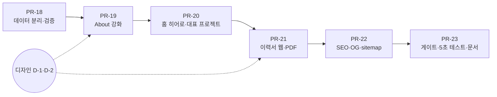

# Phase 2 포트폴리오 (About 강화·이력서·홈 소개)

> PRD-001 로드맵 Phase 2의 실행 기획서. 채용 담당자와 면접관이 "이 사람이 무엇을 했고 어떻게 일하는가"를 3분 안에 확인하게 만든다. 파일명은 링크 유지를 위해 그대로 두지만, 2026-10-30 결정으로 **별도 Projects 페이지는 만들지 않는다.**

## 0. 확정 요약

| 항목 | 결정 |
| --- | --- |
| 범위 (C안) | **About을 강화한다.** `/projects` 목록·상세 페이지는 만들지 않는다. About의 프로젝트 21건이 이미 설명·기간·성과 불릿을 갖고 있어, 별도 페이지는 같은 내용을 다시 쓰는 것이 되기 때문이다 |
| 데이터 원본 | 경력·프로젝트·이력 정보는 `content/` 데이터 파일 한 곳. About, 홈 대표 프로젝트, 이력서, 구조화 데이터가 모두 여기서 읽는다. 초기 내용은 현재 About(`src/app/about/page.tsx`, `Bio.tsx`) 문장 그대로. 저장소 루트 `resume.md`는 쓰지 않는다 |
| 프로젝트 깊이 | "어떻게 풀었는가"는 블로그 글이 맡는다. About 프로젝트 항목에 관련 글 링크를 붙인다(개인 EKS 글은 `personal` 표시) |
| 홈 | 히어로 + 대표 프로젝트 3건(EKS 네트워킹, Okta SSO, Argo Workflows). 대표 프로젝트는 About의 해당 항목으로 연결 |
| 이력서 | `/resume` 웹 페이지 + 빌드 때 자동 생성하는 `/resume.pdf`. 사진 없음 |
| 기술 스택 | 7그룹 (4.4) |
| 자격증 | Terraform Associate에 Credly 검증 링크 |
| Temporal 기간 | About 값 그대로 2개 기간(중단 후 재개) |
| 합산 수치 | 두지 않는다(디자인 05 R1 원칙) |
| 제외 | `/projects`, 프로젝트 상세, 배운 점, Mermaid 구조도, 헤더 `projects` 메뉴, 영문판, MDX |
| 결정 대기 | 없음 |

## 1. 목표

**채용 담당자(J1)가 홈이나 이력서 링크에서 들어와 3분 안에 경력·대표 성과·연락처를 확인하고, 면접관이 성과 수치 옆의 관련 글로 바로 이어서 읽는다.**

### 완료 조건 (Phase 2 게이트)

| # | 조건 | 확인 방법 |
| --- | --- | --- |
| G2-1 | **채용 5초 테스트 3명 중 3명 통과:** About 첫 화면(1280×720, 360×640)을 5초 보여 준 뒤 이름·직무·연차·연락 방법을 말할 수 있다 | 지인 3명 테스트, 결과를 `CONTEXT.md`에 기록 |
| G2-2 | `src/`에 경력·프로젝트 문자열 하드코딩 0건. About·홈·이력서가 같은 데이터에서 렌더 | grep + 데이터 하나를 고치면 세 곳이 같이 바뀌는지 확인 |
| G2-3 | 존재하지 않는 글·프로젝트를 가리키는 링크가 있으면 빌드 실패 | 깨진 fixture |
| G2-4 | E2E J1 시나리오: 홈 대표 프로젝트 → About 해당 항목(강조) → 관련 글, 이력서 PDF 다운로드 | Playwright |
| G2-5 | `/about`, `/resume`이 PRD-003 "성능 측정 기준"의 차단선 통과, 접근성 100, SEO 100 | Lighthouse CI(`/resume` 추가) |
| G2-6 | `/resume.pdf`가 빌드마다 데이터와 같은 내용으로 생성되고, 한글이 깨지지 않으며 텍스트 검색 가능, ≤ 1MB | 산출물 검사 |

## 2. 현재 상태 (2026-10-30)

| 항목 | 상태 |
| --- | --- |
| About | `about/page.tsx` 507줄 + `Bio.tsx`에 하드코딩. 소개, 기술 스택 2그룹 7개, 경력(CJ 올리브영 14건, 클래스101 7건, 프로젝트마다 설명 + 성과 불릿), 개발 활동(오픈소스 2, Lomeone), 학력·수강 과목, 자격증 3건, 기타(BoB 10기). 직함은 확정값 적용됨. Phase 0에서 색만 토큰으로 정리 |
| 공개 범위 | About 내용은 이미 공개돼 있어 그대로 옮겨도 된다(PRD-001 F-PJ-05) |
| 홈 | "Comstering's Dev Notes" 제목 + 한 줄 소개 + 글 목록. 시안 v1.4 히어로·featured 미구현 |
| 이력서 | 없음 |
| 시안 | `about.html`, `index.html`(히어로·featured)은 v1.4에 있음. `projects.html`·`project.html`은 이번에 쓰지 않음(나중을 위해 보관) |

## 3. 범위

### 포함

| 영역 | 기능 (PRD-001 ID) |
| --- | --- |
| 데이터 | 프로필·경력 데이터 분리와 검증 (F-PJ-01을 About 기준으로 축소) |
| About | 요약 우선 F-AB-01, 경력 타임라인 F-AB-02, 자격증·학력·활동 F-AB-03, 관련 글 연결 |
| 이력서 | `/resume`, `/resume.pdf` F-AB-04 |
| 홈 | 히어로 v1.4 F-HM-01, 대표 프로젝트 F-HM-02 |
| 글 → 경력 | 글 frontmatter `relatedProject`, 저자 박스 링크 F-PO-09 |
| SEO | Person 구조화 데이터, `/resume` OG·sitemap |

### 제외 (2026-10-30 결정)

| 항목 | 이유 / 다시 볼 조건 |
| --- | --- |
| `/projects` 목록 (F-PJ-02) | About 경력과 내용이 대부분 겹친다. 프로젝트 수가 About에서 읽기 어려울 만큼 늘면 다시 검토 |
| 프로젝트 상세 (F-PJ-03), 배운 점, Mermaid 구조도 | 상세 내용의 대부분이 About 설명·불릿과 같다. 길게 쓰고 싶은 프로젝트가 생기면 블로그 글로 쓰고 About에서 링크한다 |
| 헤더 `projects` 메뉴 | 페이지가 없음. 헤더는 `posts · about` 유지 |
| 영문판 F-AB-05, MDX | PRD-001 8.2 보류 그대로 |

디자인 시안 `projects.html`·`project.html`은 지우지 않고 보관한다.

## 4. 데이터 모델

### 4.1 파일 구조

```
content/
├── profile.yaml      # 이름, 직함, 연락처, 소개, what i do, 기술 스택, 학력, 자격증, 기타 경험
└── experience.yaml   # 회사 → 프로젝트(21건), 오픈소스(2), 사이드(1)
```

### 4.2 `profile.yaml`

```yaml
name: 최한수
nameEn: Choi Hansu
handle: comstering
role: DevOps · Cloud Native Engineer
careerStart: 2022-05          # "경력 N년+"를 빌드 때 계산(내림). 2026-10 기준 4년+
contacts:
  email: comstering@gmail.com
  github: https://github.com/comstering
  linkedin: https://www.linkedin.com/in/hansu-choi-05775a244
headline: 개발과 운영의 경계를 좁혀 비즈니스의 연속성을 만드는 엔지니어입니다.   # Bio.tsx
intro: |                      # Bio.tsx 소개 문단 그대로
  ...
capabilities:                 # what i do 3개 (시안 v1.4 문구). link = About 경력의 프로젝트 id
  - title: Kubernetes 플랫폼 설계·운영
    summary: EKS · Karpenter · Cilium · Istio로 MSA 인프라를 처음부터 구축
    link: eks-networking
skills:                       # 4.4 표 그대로
  - group: platform
    items: [Kubernetes, EKS, Karpenter, Helm, Docker, Kubernetes Operator, Istio, Cilium, Hubble, Kiali]
education: [...]              # 학력 + 수강 과목(About 그대로)
certifications:
  - name: "HashiCorp Certified: Terraform Associate (004)"
    issuer: HashiCorp
    date: 2026-04
    verifyUrl: https://www.credly.com/badges/476460b7-b5dc-4918-804e-ea3a169435d2/public_url
  - { name: 정보처리기사, issuer: HRDK, date: ... }
  - { name: 정보보안산업기사, issuer: KISA, date: ... }
experiences: [...]            # 기타 경험(BoB 10기, About 그대로)
```

### 4.3 `experience.yaml`

```yaml
companies:
  - id: cj-oliveyoung
    name: CJ Olive Young
    role: DevOps · Cloud Native Engineer
    period: { start: 2024-06 }                    # end 없음 = 재직 중
    projects:
      - id: eks-networking                        # About 앵커(/about#eks-networking)
        title: AWS EKS 네트워킹 아키텍처 고도화
        period: { start: 2025-06, end: 2025-06 }
        description: Pod IP 고갈 문제 및 VPC CNI의 iptables 성능 한계를 극복하기 위해 …   # About 그대로
        points:                                   # About 그대로
          - VPC Secondary CIDR(100.64.0.0/16)대역을 이용한 … 500개 → 16,000개로 32배 확장
        stack: [EKS, Cilium, Terraform]           # 4.4 기술 이름 중에서만
        featured: true                            # 홈 대표 프로젝트, 최대 3건
        relatedPosts:
          - { slug: eks-custom-networking, context: personal }
      - id: temporal
        title: Temporal 기반 분산 워크플로우 엔진 구축
        period:                                   # 중단 후 재개: 기간 여러 개
          - { start: 2025-05, end: 2026-03 }
          - { start: 2026-01, end: 2026-02 }
  - id: class101
    name: CLASS 101
    role: Web Developer (backend 중심)
    period: { start: 2022-05, end: 2024-03 }
    projects: [...]
openSource:                                       # 2건
  - { id: bitnami-schema-registry, title: …, period: { start: 2025-08 }, url: https://github.com/bitnami/charts/pull/35772, status: merged, relatedPosts: [{ slug: bitnami-helm-chart-contribute, context: work }] }
sideProjects:                                     # Lomeone
  - …
```

- 기간이 비어 있는 항목(About의 "플랫폼 안정성 및 컴플라이언스 개선 작업")은 `period`를 생략할 수 있고, 회사 목록 맨 끝에 둔다.
- 기간이 여러 개면 화면에 About처럼 쉼표로 이어 표시하고, 정렬은 첫 기간의 `start` 기준.
- `stack`은 이력서·홈 대표 프로젝트 표시용이다. About에 기술 태그를 보일지는 디자인이 정한다(8장 D-1).

### 4.4 기술 스택 (확정)

| 그룹 | 기술 |
| --- | --- |
| platform | Kubernetes, EKS, Karpenter, Helm, Docker, Kubernetes Operator, Istio, Cilium, Hubble, Kiali |
| cloud · iac | AWS, Cloudflare, Terraform |
| ci/cd · workflow | GitHub Actions (ARC), Argo Workflows, Argo CD, GitOps, Temporal |
| data · messaging | Kafka, Kafka Connect, Debezium, Schema Registry, MongoDB, PostgreSQL, MySQL |
| auth · security | Keycloak, Okta, OAuth 2.0 / OIDC, JWT, OAuth2 Proxy, External Secrets Operator |
| backend | Kotlin, Spring Boot |
| observability | Datadog |

- 그룹 순서와 그룹 안 순서는 표 그대로.
- Argo CD는 About 본문에 없지만 작성자가 추가했다.
- 넣지 않은 것: Drone CI, React Native, Braze, CloudFront, MWAA.

### 4.5 검증 (빌드 실패 조건, F-SE-07 확장)

| 규칙 |
| --- |
| 필수 필드 누락(회사 `id`·`name`·`role`·`period`, 프로젝트 `id`·`title`·`description`) |
| 프로젝트 `id` 중복 |
| `featured: true`가 3건 초과 |
| `relatedPosts[].slug`가 없는 글이거나 draft 글, `context`가 `personal`·`work`가 아님 |
| 글 frontmatter `relatedProject`가 없는 프로젝트 `id` |
| `capabilities[].link`가 없는 프로젝트 `id` |
| `stack`에 4.4 표에 없는 기술 이름 |
| 각 기간의 `end`가 `start`보다 빠름, 회사 기간 밖의 프로젝트 기간 |
| `src/` 안에 프로젝트 제목 문자열이 남아 있음(G2-2, CI 검사) |

## 5. 화면별 요구사항

### 5.1 About (`/about`)

| 순서 | 섹션 | 내용 |
| --- | --- | --- |
| 1 | 첫 화면 | 이름(한·영), **직함 · 경력 N년+**(본문 크기 `fg`, 디자인 08 M2), 현재 회사, 버튼 `email`(primary) · `resume.pdf`, 링크 `github ↗` · `linkedin ↗`. 360×640에서 스크롤 없이 모두 보임 |
| 2 | 소개 | `headline` + `intro`. 강조는 굵기만(accent 금지) |
| 3 | what i do | `capabilities` 3개, 각각 About 안의 대표 프로젝트 항목으로 이동 |
| 4 | experience | 회사별 타임라인. 회사명·기간·직함 → 프로젝트(제목, 기간, 설명, 성과 불릿). **관련 글이 있는 프로젝트는 항목 끝에 `관련 글 →` 목록**(글 제목, 개인 환경 글은 `personal`). 항목마다 `id`(`/about#eks-networking`)를 두고, 앵커로 들어오면 해당 항목을 `surface-2`로 강조(디자인 08 H2) |
| 5 | open source · side | 오픈소스 2건(PR 링크, `merged`), Lomeone(`github ↗`) |
| 6 | skills | 4.4의 7그룹 |
| 7 | certifications | 이름·발급 기관·날짜, Terraform Associate에 `verify ↗` |
| 8 | education · activity | 학력·수강 과목, BoB 10기 |

- 프로젝트 21건의 불릿까지 모두 펼치면 페이지가 길다. 펼침 방식(전부 펼침 / 회사별 접기 / 프로젝트별 접기)은 디자인이 정한다(8장 D-1). 단 앵커로 들어온 항목은 펼친 상태로 보여야 한다.

### 5.2 홈 (F-HM-01·02)

| 항목 | 요구사항 |
| --- | --- |
| 히어로 | 시안 v1.4: "개발과 운영의 경계를 좁히는 클라우드 네이티브 엔지니어" + 커서 `_`(깜빡임은 이 한 곳만, reduced motion이면 정지) → 이름 → 핵심 스택 5개 → `about me →`(primary) · `resume`(secondary). 시안의 `projects` 버튼은 `resume`으로 바꾼다. 문구는 `profile.yaml`에서 |
| 대표 프로젝트 | `featured: true` 3건(EKS 네트워킹, Okta SSO, Argo Workflows). 연도 · 제목 · 대표 수치 한 줄. 누르면 `/about#<id>`. 1024 이상 오른쪽 열, 1024 미만은 1건 + `about →` |
| 사이드 열 | 시리즈 2개, 태그 상위 6개. `all tags →`는 태그 페이지(Phase 3)가 생기면 추가 |
| 글 목록 | Phase 1 그대로 |
| 첫 화면 | 1280×720에서 첫 글 제목이 보임 |

대표 수치 한 줄은 About 불릿에 있는 값만 쓴다: EKS 네트워킹 `Pod IP 500 → 16,000`, Okta SSO `IAM User 250+ 폐기`, Argo Workflows `MWAA 제거 연 $16,000 절감`. 데이터에 `metric` 필드로 둔다.

### 5.3 이력서 (`/resume`, `/resume.pdf`)

| 항목 | 요구사항 |
| --- | --- |
| 내용 | 사진 없음. 연락처 → 소개 → 기술 스택 → 경력(회사 → 프로젝트 → 설명·불릿) → 오픈소스·사이드 → 학력 → 자격증 → 기타 경험. About과 같은 데이터, 인쇄용 배치 |
| 웹 페이지 | `/resume`: 사이트 헤더·푸터 포함, 읽기 폭 720px, 상단에 `resume.pdf` 다운로드 버튼 |
| PDF | CI 빌드 후 Playwright로 `/resume`을 A4로 인쇄해 `out/resume.pdf` 생성. 인쇄 스타일은 라이트 고정, 헤더·푸터·버튼 숨김, 링크는 URL이 보이게 |
| 디자인 | 시안 필요(8장 D-2) |

### 5.4 글 → 경력 연결 (F-PO-09)

| 항목 | 요구사항 |
| --- | --- |
| 글 frontmatter | `relatedProject`(선택, 프로젝트 `id`). 있으면 글 저자 박스에 `관련 경력 →`(`/about#<id>`) |
| 양방향 확인 | 프로젝트 `relatedPosts`와 글 `relatedProject`가 서로 맞지 않으면 빌드 경고 |
| 연결 초안 | EKS 네트워킹 ↔ Custom Networking·ENI 트러블슈팅·Cilium 설치·Cilium 트러블슈팅(`personal`), Kafka 에코시스템 안정성·오픈소스(Bitnami) ↔ Bitnami 기여 글(`work`), 오픈소스(Kafbat) ↔ Kafbat 기여 글(`work`). 개발이 PR에 목록을 올리고 작성자가 확인 |

### 5.5 SEO

| 항목 | 요구사항 |
| --- | --- |
| JSON-LD | About: `Person`(name, alternateName, jobTitle, worksFor, sameAs, alumniOf, hasCredential)을 `profile.yaml`에서 |
| OG | `/resume`도 PR-15 OG 생성기로 이미지 생성 |
| sitemap | `/resume` 추가 |

## 6. 작업 목록 (PR 단위)

**시작 조건:** Phase 1 게이트(PRD-003 PR-17) 통과 후. 디자인 요청(8장)은 지금 시작한다.

순서: PR-18 → PR-19 → PR-20 → PR-21 → PR-22 → PR-23



| PR | 내용 | 수용 기준 |
| --- | --- | --- |
| PR-18 데이터 분리·검증 | `content/profile.yaml`, `content/experience.yaml`, 스키마(zod), 4.5 검증. `about/page.tsx`·`Bio.tsx` 문장을 바꾸지 않고 옮긴다(바뀌는 것은 기술 스택 7그룹뿐). 글 `relatedProject` 추가(5.4 초안) | 4.5 규칙별 깨진 fixture에서 빌드 실패. 이전 전후 텍스트 비교를 PR 설명에 첨부. 화면은 아직 그대로 |
| PR-19 About 강화 | 5.1. `Bio`·`ExperienceItem`·`ActivityCard` 정리 또는 교체. 연차 빌드 때 계산 | 360×640 첫 화면에 이름·직함·연차·회사·email·resume. `about/page.tsx`에 경력 문자열 0건. 앵커 진입 시 강조·펼침. **About이 성능 차단선(성능 ≥ 90, TBT ≤ 300ms) 통과 → `lighthouserc.json`의 About 예외(Q13) 해제** |
| PR-20 홈 히어로·대표 프로젝트 | 5.2 | 1280×720 첫 글 제목 보임, 1024 미만 대표 1건, 커서 깜빡임은 히어로 1곳 |
| PR-21 이력서 | 5.3. 신규 `src/app/resume/page.tsx`, 인쇄 CSS, `scripts/build-resume-pdf.mjs`, deploy·CI 워크플로에 PDF 단계 | G2-6. PDF 텍스트에 직함·회사·연락처 포함 |
| PR-22 SEO | 5.5, `lighthouserc.json`에 `/resume` 추가 | G2-5, Rich Results Test 오류 0 |
| PR-23 게이트·문서 | E2E J1(G2-4), 5초 테스트(G2-1), `README.md`에 "경력 수정 방법"(`content/` 안내), `DESIGN.md`·`CONTEXT.md` 갱신 | G2-1~G2-6 기록 |

## 7. 결정 기록

| # | 항목 | 결정 |
| --- | --- | --- |
| 1 | Temporal 기간 | About 값 그대로, 기간 2개(중단 후 재개) |
| 2 | 상세 페이지·Projects | **만들지 않음(C안).** 대표 프로젝트 3건(EKS 네트워킹, Okta SSO, Argo Workflows)은 홈에서 About 항목으로 연결 |
| 3 | 이력서 | 빌드 때 자동 PDF, About과 같은 내용, 사진 없음 |
| 4 | 자격증 | Terraform Associate (004) Credly 링크 |
| 5 | 기술 스택 | 4.4의 7그룹 |

## 8. 디자인 요청

| # | 우선 | 내용 |
| --- | --- | --- |
| D-1 | 필수 | **About 경력 시안(실제 데이터 21건):** 프로젝트별 관련 글 목록(`personal` 표시), 앵커 도착 강조, 기술 태그 표시 여부, 21건 펼침 방식(전부 / 회사별 접기 / 프로젝트별 접기). 360px 길이 고려 |
| D-2 | 필수 | **이력서 시안 `resume.html`:** 웹 + A4 인쇄(라이트 고정, 헤더·푸터·버튼 숨김, 링크 URL 표시, 사진 없음) |
| D-3 | 필수 | **About 나머지 갱신:** 기술 스택 7그룹, Credly `verify ↗`, `.ph` 잔존 정리 |
| D-4 | 필수 | **홈 히어로·대표 프로젝트:** `projects` 버튼 → `resume`, 대표 3건이 About 항목으로 연결, `all tags →` 제거 |

## 9. 리스크

| 리스크 | 대응 |
| --- | --- |
| About 내용 이전 중 문장·수치가 바뀜 | 문장 그대로 옮기고 PR-18 설명에 전후 텍스트 비교 첨부 |
| About이 21건 불릿으로 너무 길어짐 | 디자인 D-1 펼침 방식. 5초 테스트는 첫 화면만 보므로 영향 없음 |
| 대표 프로젝트를 눌렀는데 About의 긴 페이지 중간으로 떨어져 맥락을 잃음 | 앵커 도착 항목 강조 + 펼침, 회사명이 보이는 위치로 스크롤(`scroll-margin-top`) |
| 이력서 PDF 생성이 CI에서 깨짐 | Playwright Chromium은 이미 CI에 있음. 실패 시 배포를 막지 않고 직전 PDF 유지 여부를 PR-21에서 정함 |
