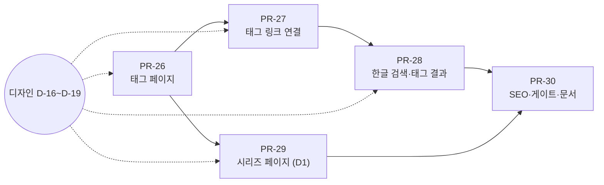

# Phase 3 탐색 (태그·시리즈 페이지, 한글 검색)

> PRD-001 로드맵 Phase 3의 실행 기획서. Phase 2에서 홈은 블로그, 검색은 헤더 팔레트가 됐다. Phase 3은 **읽은 글에서 같은 주제의 다음 글로 이어지게** 만든다. 독자가 주제(태그)와 묶음(시리즈)으로 글을 찾고, 한글로 쳐도 검색이 되게 한다.

## 0. 확정 요약

| 항목 | 결정 |
| --- | --- |
| 목표 | 한 편을 읽은 독자가 같은 주제 글을 2편 더 찾는다(J4). 검색 유입(J2)의 두 번째 페이지 조회를 늘린다 |
| 범위 | ① 태그 페이지 `/tags`, `/tags/[tag]` (F-SR-04) ② 시리즈 페이지 `/series/[slug]` (F-SR-05, 신규) ③ 태그 링크 연결: 홈 사이드바·글 상세·검색 팔레트 (F-SR-01 보완) ④ 한글 검색: 초성·별칭·표기 정규화 (F-SR-03) |
| 커스텀 도메인 | **`comstering.github.io` 유지**(작성자 2026-11-08). 도메인 이전 작업 없음. PRD-001 8.2 종결 |
| 영문 About | **나중에 결정**(작성자 2026-11-08). Phase 3 범위에서 뺀다. PRD-001 4.3 보류로 이동 |
| 카테고리 | 페이지를 따로 만들지 않는다. 홈 카테고리 칩과 필터 URL(`/?category=infra`)이 맡는다 |
| 태그 별칭 | 글 frontmatter는 지금처럼 정규 태그만(별칭이면 빌드 실패). 별칭은 **검색에서만** 쓴다. 별칭 URL(`/tags/k8s`)은 만들지 않는다 |
| 제외 | 페이지네이션 F-HM-05(조건: 글 30편 초과, 지금 14편), 본문 전체 검색(Pagefind), 영문 About F-AB-05, 백로그(`/now`, 뉴스레터, Mermaid 등) |
| 결정 대기 | **D1 시리즈 페이지를 이번에 넣을까?**(기획 추천: 넣는다, 3장) · **D2 글 1편뿐인 태그 페이지의 검색엔진 노출**(기획 추천: 페이지는 만들되 `noindex`, sitemap 제외, 5.1) |

## 1. 목표

**검색으로 글 한 편에 들어온 독자가 태그나 시리즈를 눌러 같은 주제 글을 이어 읽는다. 사이트 안 검색은 "카펜터", "k8s", "ㅎㄱ"처럼 쳐도 찾는다.**

### 완료 조건 (Phase 3 게이트)

| # | 조건 | 확인 방법 |
| --- | --- | --- |
| G3-1 | **E2E J4:** ① 글 상세 하단 태그 → `/tags/<tag>` → 다른 글 ② 홈 사이드바 태그 → 태그 페이지 ③ 글의 시리즈 박스 → `/series/<slug>` → 다른 편 | Playwright |
| G3-2 | **검색:** `카펜터` → Karpenter 글, `k8s` → `#kubernetes` 태그 결과와 글, `custom networking` → `custom-networking` 글, 초성 `ㅎㄱ` → 제목에 "후기"가 든 글. 태그 결과 Enter → 태그 페이지 | Playwright + 인덱스 단위 테스트 |
| G3-3 | `/tags`, `/tags/kubernetes`, `/series/eks-from-scratch`가 PRD-001 5.1 차단선 통과, 접근성 100, SEO 100 | Lighthouse CI(페이지 3개 추가) |
| G3-4 | 검색 인덱스 ≤ 50KB gzip(글 100편 가정 fixture), 인덱스 로드 후 첫 결과 ≤ 100ms(Phase 2 기준 그대로, archive/phase-2_summary.md) | 빌드 산출물 검사, 성능 테스트 |
| G3-5 | 모든 정규 태그·시리즈에 페이지가 있고, 사이트 안 태그·시리즈 링크가 깨지지 않는다. 글이 0편인 태그(draft 전용 포함)는 페이지·링크 모두 없다 | 빌드 검사 + 링크 체커 |
| G3-6 | 태그·시리즈 페이지 조회수를 GoatCounter에서 볼 수 있다(목표 수치 없음, 다음 분기 KPI 기준치) | 배포 후 GoatCounter 확인 |

## 2. 현재 상태 (2026-11-08, Phase 2 완료 시점)

| 항목 | 상태 |
| --- | --- |
| 글 | 공개 14편(+ draft 1). 카테고리 infra 11 · frontend 2 · oss 2 · note 1 |
| 태그 | 정규 태그 29개 사용 중(`content/tags.yaml`, 별칭 포함). **2편 이상 16개, 1편뿐 13개.** 상위: eks 8, kubernetes 7, aws 6 |
| 시리즈 | 2개(`eks-from-scratch` 5편, `cilium-on-eks` 3편, `content/series.yaml`). 글 상세에 시리즈 박스, 홈 사이드바 시리즈는 **1편으로 링크** |
| 태그 노출 | 홈 사이드바 `tags`(상위 10, 글 수): 누르면 **검색 팔레트를 그 태그로 연다**(`TagButton`, 태그 페이지가 없어서 임시). 글 상세 하단 `#tag`: **링크 아님**. 홈 목록 항목 `#tag`(최대 4개): 항목 전체가 글 링크라 태그는 글자만 |
| 검색 | 헤더 `⌘K` 팔레트(PR-20). 글만 검색(제목·설명·태그·카테고리·소제목), 대소문자 무시·부분 일치. 별칭·초성·띄어쓰기/하이픈 차이는 처리하지 않음 |
| 시안 | `cowork/design/site/tags.html`·`tag.html`이 v1.4(Phase 0) 시안으로 보관돼 있다. Phase 2 헤더·사이드바 반영 여부는 디자인 확인 필요 |

## 3. 범위와 기능

| ID | 기능 | 우선 | 요약 |
| --- | --- | --- | --- |
| F-SR-04 | 태그 페이지 | P0 | `/tags`(전체 태그, 글 수), `/tags/[tag]`(그 태그의 글 목록) |
| F-SR-05 | 시리즈 페이지 (신규) | P1 | `/series/[slug]`(시리즈 제목, 소개 한 줄, 편 순서대로 목록). **결정 대기 D1** |
| F-SR-01 (보완) | 태그 링크 연결 | P0 | 홈 사이드바 태그·글 상세 태그 → 태그 페이지. 검색 팔레트에 태그 결과 그룹 |
| F-SR-03 | 한글 검색 | P1 | 별칭 사전, 초성 검색, 띄어쓰기·하이픈·대소문자 정규화 |

**D1 시리즈 페이지를 넣자는 이유:** 지금 홈 사이드바 시리즈는 1편으로만 간다. 시리즈의 전체 편 목록은 글 상세 안의 시리즈 박스에서만 보여, 처음 온 독자가 "몇 편짜리이고 무엇을 다루는지"를 한 화면에서 볼 곳이 없다. 페이지 하나와 링크 2곳만 바꾸면 되는 작은 기능이다. 빼면 사이드바는 지금처럼 1편 링크로 둔다.

## 4. 데이터

### 4.1 태그

```yaml
# content/tags.yaml (지금 형식 유지: 키 = 정규 태그, 값 = 별칭 목록)
kubernetes: [k8s, 쿠버네티스]       # 한글 별칭을 같은 목록에 추가
karpenter: [카펜터]
cilium: [실리움]
terraform: [테라폼]
```

- 한글 별칭도 `tags.yaml`의 별칭 목록에 넣는다. 파일을 따로 만들지 않는다. 글 frontmatter에 별칭을 쓰면 지금처럼 빌드 실패.
- 별칭 초안은 PR-28에서 개발이 만들고 작성자가 확인한다(사용 중인 29개 중 한글로 칠 만한 것: kubernetes, karpenter, cilium, terraform, kafka, helm, eks 등).
- 태그 표시 이름은 정규 태그 그대로(`#kubernetes`). 별도 표시 이름 필드는 두지 않는다.

### 4.2 시리즈 (D1을 넣을 때)

```yaml
# content/series.yaml에 description 한 줄 추가(선택)
eks-from-scratch:
  label: eks
  title: EKS를 처음부터 구축하고 운영하기
  description: VPC부터 Karpenter까지 개인 AWS 계정에서 EKS를 직접 만들어 보는 기록   # 작성자가 씀
```

`description`이 없으면 시리즈 페이지에서 소개 줄을 숨긴다.

### 4.3 검증 (빌드 실패 조건, 기존 규칙에 추가)

| 규칙 |
| --- |
| 별칭이 두 정규 태그에 동시에 속함, 별칭이 다른 정규 태그 이름과 같음 |
| 정규 태그 이름이 URL에 쓸 수 없는 문자(소문자 영문·숫자·하이픈 외)를 가짐 |
| 시리즈 slug 규칙 동일, `description` 160자 초과 |

## 5. 화면별 요구사항

### 5.1 태그 목록 `/tags`

| 항목 | 요구사항 |
| --- | --- |
| 내용 | 공개 글이 1편 이상인 정규 태그 전부. 태그 이름 + 글 수 |
| 정렬 | 글 수 내림차순, 같으면 이름순. 디자인이 가나다/알파벳 묶음이 낫다고 보면 제안(8장) |
| 제목 | h1 `tags`(사이트 말투), 경로 `~/tags` |
| 메타 | title `tags · Comstering`, description "주제별로 글 찾기. 태그 N개" |
| 진입 | 홈 사이드바 `tags` 블록 끝 `all tags →`(Phase 2에서 예약), 태그 상세의 `← all tags`, 검색 팔레트 태그 그룹. 헤더 메뉴는 `posts · about` 그대로 |

### 5.2 태그 상세 `/tags/[tag]`

| 항목 | 요구사항 |
| --- | --- |
| 내용 | h1 `#kubernetes`, 글 수, 글 목록(홈 목록과 같은 항목 모양, 최신순, 연도 묶음은 디자인 판단) |
| 관련 태그 | 이 태그와 같이 많이 쓰인 태그 최대 5개(선택, 디자인 판단). 링크는 각 태그 페이지 |
| 메타 | title `#kubernetes · Comstering`, description "kubernetes 태그 글 N편: 최근 글 제목 2개…", canonical 자기 자신, OG는 `renderOg`로 `#kubernetes` 카드 |
| **D2 1편 태그** | 글이 1편뿐인 태그(지금 13개)도 페이지는 만든다(링크가 깨지지 않게). **`noindex` + sitemap 제외**를 추천: 글 하나를 다시 보여 주는 얇은 페이지가 검색 결과에 섞이면 사이트 품질 신호가 떨어진다. 2편이 되면 자동으로 색인 대상이 된다 |
| URL | 정규 태그 이름 그대로(`/tags/custom-networking`). 정적 export라 별칭 리다이렉트는 만들지 않는다 |

### 5.3 시리즈 `/series/[slug]` (D1)

| 항목 | 요구사항 |
| --- | --- |
| 내용 | h1 시리즈 제목, `description`, 편 수, 편 목록(`1/5` 순서 번호 + 글 제목 + 날짜). 순서는 `seriesOrder` |
| 진입 | 홈 사이드바 시리즈(지금 1편 링크 → 시리즈 페이지), 글 상세 시리즈 박스 제목 |
| 목록 | `/series` 목록 페이지는 만들지 않는다(시리즈 2개, 사이드바가 목록 역할) |
| 메타 | title `<시리즈 제목> · Comstering`, sitemap 포함, OG `renderOg` |

### 5.4 태그 링크 연결

| 위치 | 지금 | 바꿈 |
| --- | --- | --- |
| 홈 사이드바 `tags` | 버튼: 검색 팔레트를 태그로 연다 | **링크:** `/tags/<tag>`. 블록 끝에 `all tags →` |
| 글 상세 하단 `#tag` | 글자 | **링크:** `/tags/<tag>`(터치 영역 44px, NF-04) |
| 홈 목록 항목 `#tag` | 글자(항목 전체가 글 링크) | 그대로. 링크 안에 링크를 넣지 않는다 |
| 검색 팔레트 | 글 결과만 | **태그 그룹 추가**(5.5) |

### 5.5 검색 보완 (F-SR-01 보완, F-SR-03)

| 항목 | 요구사항 |
| --- | --- |
| 태그 결과 | 검색어가 정규 태그나 별칭과 맞으면 결과 맨 위에 `tags` 그룹(최대 3개, `#kubernetes 7`). Enter → 태그 페이지. 아래에 글 결과 그대로 |
| 별칭 | 검색어를 정규화한 뒤 `tags.yaml` 별칭과 맞으면 정규 태그로 바꿔 검색한다(`카펜터` → `karpenter`, `k8s` → `kubernetes`). 원래 검색어로도 함께 찾는다 |
| 정규화 | 대소문자 무시(지금), **띄어쓰기·하이픈·밑줄 무시**(`custom networking` = `custom-networking` = `customnetworking`), 한글 자모 정규화(NFC) |
| 초성 | 검색어가 한글 초성만으로 이루어졌으면(2자 이상) 제목·태그 별칭의 한글 초성과 비교한다(`ㅎㄱ` → "후기"). 본문 소제목은 초성 대상에서 뺀다(오탐이 많음) |
| 가중 | 지금 순서(제목 → 설명·태그·카테고리 → 소제목) 유지. 별칭으로 맞은 경우는 태그 일치와 같게, 초성 일치는 가장 낮게 |
| 빈 결과 문구 | "제목, 태그, 소제목으로 찾습니다" 뒤에 "한글 이름(카펜터)이나 초성(ㅋㅍㅌ)으로도 찾을 수 있습니다" 같은 안내를 디자인이 정한다 |
| 인덱스 | 빌드 때 별칭 표·초성 문자열을 인덱스에 넣는다. 크기 기준 G3-4 |

## 6. 품질·SEO

| 항목 | 요구사항 |
| --- | --- |
| sitemap | `/tags`, 2편 이상 태그의 `/tags/[tag]`, `/series/[slug]` 추가 |
| 구조화 데이터 | 태그·시리즈 페이지에 `CollectionPage` + `BreadcrumbList`(홈 → tags → #tag). 시리즈는 `ItemList`(편 순서) |
| 성능 | 새 페이지는 정적 HTML, 클라이언트 JS 추가 없음. 측정 대상 3개 추가(G3-3) |
| 접근성 | 태그 링크 이름은 보이는 글자 그대로(`#kubernetes`), 글 수는 `<small>`로 이름 뒤에. 목록은 `ul`/`ol`, 시리즈는 순서가 있어 `ol` |
| GoatCounter | 별도 이벤트 없음. 경로(`/tags/…`, `/series/…`) 조회수로 G3-6 |

## 7. 작업 목록 (PR 단위)

순서: PR-26 → PR-27 → PR-28 → PR-29 → PR-30



| PR | 내용 | 수용 기준 |
| --- | --- | --- |
| PR-26 태그 페이지 | 5.1·5.2. `/tags`, `/tags/[tag]`(`generateStaticParams`), 태그 OG, 4.3 검증, D2 정책(`noindex`·sitemap) | G3-5. 1편 태그 페이지에 `noindex`, 2편 이상만 sitemap. Lighthouse 2페이지 차단선 |
| PR-27 태그 링크 연결 | 5.4. 사이드바 `TagButton` → 링크, `all tags →`, 글 상세 태그 링크 | G3-1 ①② |
| PR-28 한글 검색·태그 결과 | 5.5. 인덱스에 태그·별칭·초성, 정규화, 팔레트 `tags` 그룹, `tags.yaml` 한글 별칭 초안(작성자 확인) | G3-2, G3-4 |
| PR-29 시리즈 페이지 | 5.3. `/series/[slug]`, 사이드바·시리즈 박스 링크, `series.yaml` `description`(작성자가 씀). **D1에서 빼기로 하면 이 PR은 없다** | G3-1 ③, Lighthouse 1페이지 |
| PR-30 SEO·게이트·문서 | 6장 구조화 데이터·sitemap 확인, E2E J4, `README.md`에 "태그 별칭 추가 방법", `DESIGN.md`·`CONTEXT.md` 갱신 | G3-1~G3-6 기록 |

**작성자 할 일:** D1·D2 결정(지금), 한글 별칭 초안 확인(PR-28), 시리즈 소개 한 줄 2개 작성(PR-29).

## 8. 디자인 요청

규칙상 기획은 `cowork/prd`에만 쓴다. 디자인은 이 장을 요청으로 보고 답변을 `cowork/design`에 번호 문서로 남긴다.

| # | 우선 | 내용 | 쓰는 PR |
| --- | --- | --- | --- |
| D-16 | 필수 | **태그 목록·상세 시안:** 보관 중인 `site/tags.html`·`tag.html`(v1.4)을 Phase 2 셸(헤더 검색, 경로, 사이드바 유무)에 맞춰 갱신. `/tags` 정렬(글 수 순 vs 알파벳 묶음)과 1편 태그 표시(흐리게/같게) 제안. 태그 상세의 관련 태그 블록을 넣을지 판단. 태그 OG 카드(`#kubernetes`) | PR-26 |
| D-17 | 필수 | **태그 링크 모양:** 홈 사이드바 태그(버튼 → 링크, `all tags →`), 글 상세 하단 `#tag` 링크(44px 터치 영역, hover) | PR-27 |
| D-18 | 필수 | **검색 팔레트 태그 그룹:** `tags` 그룹 라벨, 태그 결과 행(`#kubernetes 7`), 글 결과와의 구분, 별칭으로 맞았을 때 표시("k8s → kubernetes" 같은 보조 줄을 둘지), 빈 결과 안내 문구(5.5) | PR-28 |
| D-19 | D1 | **시리즈 페이지:** 제목·소개·편 목록(`1/5`), 지금 글 상세 시리즈 박스와의 일관성, 홈 사이드바 시리즈 링크 대상 변경 | PR-29 |

## 9. 리스크

| 리스크 | 대응 |
| --- | --- |
| 1편 태그 13개가 얇은 페이지로 색인 | D2: `noindex` + sitemap 제외, 2편이 되면 자동 포함 |
| 태그가 너무 잘게 나뉨(29개 중 13개가 1편) | 이번 Phase에서 태그를 합치지는 않는다. 새 글을 쓸 때 기존 태그를 먼저 쓰도록 `README.md` 글 작성 안내에 한 줄 추가(PR-30) |
| 초성 검색 오탐 | 2자 이상, 제목·한글 별칭만 대상, 가중 최하 |
| 별칭 사전 관리 부담 | 정규 태그에 대해서만, 작성자가 실제로 쳐 볼 말만. 없으면 비워 둔다 |
| 인덱스 크기 증가 | 초성 문자열은 제목 단위만. G3-4로 감시 |
